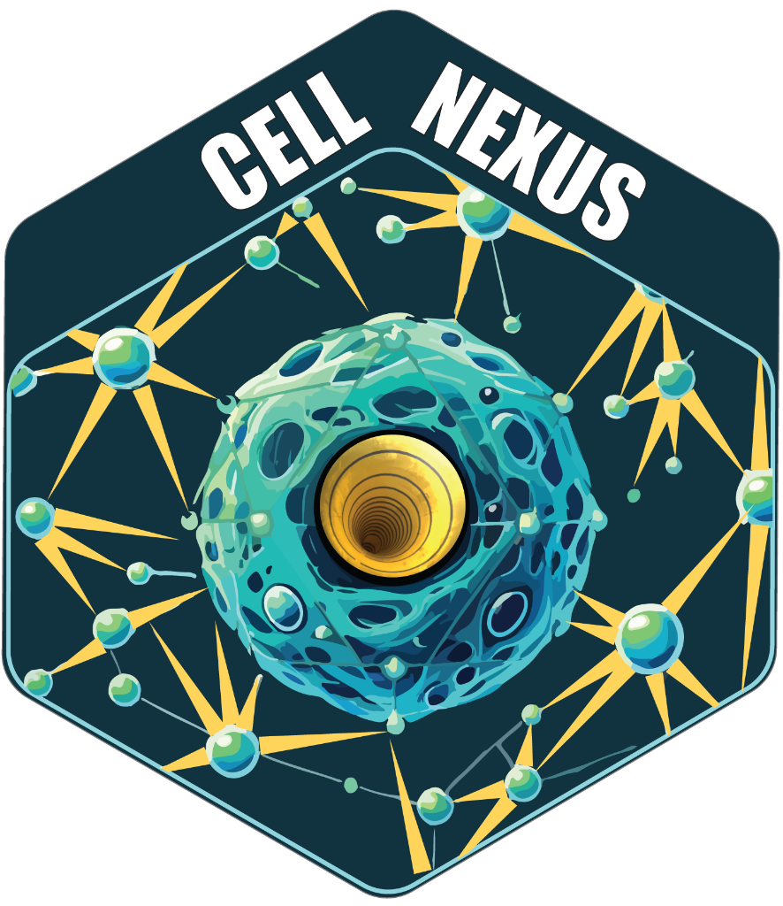
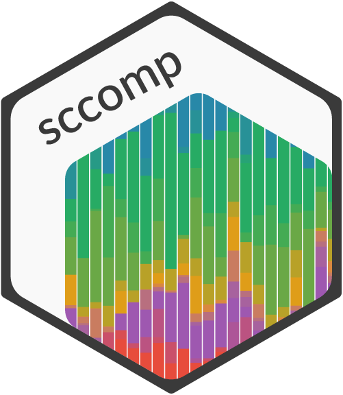

# cellNexusWorkshop

<p style="text-align: left;">


</p>

Hands-on BiocAsia workshop. From a curated Human Cell Atlas query to donor-level composition and expression analysis, in R.

This is the page to follow during the session. Read this page, then the articles in order. The session is open to all levels of R experience. Each article shows the commands to run.

## Instructor names and contact information

* Mengyuan Shen <shen.m@wehi.edu.au>
* Yingnan Gao <yingnan.gao@adelaide.edu.au>
* Stefano Mangiola <stefano.mangiola@adelaide.edu.au>

## Syllabus

Follow these articles in one R session.

- [Query the atlas](articles/query_the_atlas.html)
- [Explore and visualise](articles/explore_and_visualise.html)
- [Compositional analysis](articles/compositional_analysis.html)
- [Gene expression](articles/gene_expression.html)
- [Solutions](articles/solutions.html)

## Package installation

The commands below are for preparing a machine. The workshop targets R 4.5 or later. `cellNexus` is installed from GitHub. Install CmdStan before the first `sccomp` fit so the session does not stop on a compiler.

```r
install.packages("BiocManager")
install.packages("remotes")
Sys.setenv("R_REMOTES_NO_ERRORS_FROM_WARNINGS" = "true")

install.packages(
  "cmdstanr",
  repos = c("https://mc-stan.org/r-packages/", getOption("repos"))
)
cmdstanr::check_cmdstan_toolchain(fix = TRUE)
cmdstanr::install_cmdstan()

BiocManager::install(c(
  "dplyr", "tidyr", "ggplot2", "patchwork", "stringr", "Matrix",
  "SummarizedExperiment", "SingleCellExperiment",
  "scater", "scran", "scuttle", "scrapper", "bluster", "harmony",
  "DESeq2", "org.Hs.eg.db", "AnnotationDbi", "singscore",
  "tidySingleCellExperiment", "tidySummarizedExperiment",
  "tidybulk", "tidyseurat", "tidyomics", "Seurat",
  "dbplyr", "duckdb"
))

remotes::install_github("MangiolaLaboratory/cellNexus")
remotes::install_github("MangiolaLaboratory/sccomp")
remotes::install_github("myushen/cellNexusWorkshop")
```

From a clone of this repository, install the workshop package with `remotes::install_local(".", dependencies = FALSE)` after the packages above.

A Docker image that runs the same install is `Dockerfile`, based on `bioconductor/bioconductor_docker:devel`.

Open the reusable script after installation:

```r
file.edit(system.file(
  "scripts", "workshop_respiratory_ageing.R",
  package = "cellNexusWorkshop"
))
```

## Workshop description

In this session you will use cellNexus to query and download a curated subset of atlas data by tissue, cell type, or disease status, then explore and visualise the data with the tidyomics packages. You will then run a gene-expression analysis and use sccomp for a compositional analysis. By the end of the session you will have an R script that takes you from the Human Cell Atlas to these analyses.

### Pre-requisites

* No prior R experience is required. The articles show each command.
* An R 4.5 session with the packages above, and CmdStan installed

### Workshop participation

The workshop format is a 90 minute session consisting of hands-on demos, exercises and questions. Run the article code in order, in one R session. Each exercise has a solution hidden underneath it. The [Solutions](articles/solutions.html) page collects the same answers.


The website shows the code. Run it in R to see your own results. The figures already on the site are examples from a larger download (12,000 cells, and a slower `sccomp` fit). During the session the download is capped at 4,000 cells and `sccomp` uses Pathfinder, which finishes sooner, so your figures can look a little different. To match the example figures, set `CELLNEXUS_WORKSHOP_MAX_CELLS=12000` and `CELLNEXUS_WORKSHOP_INFERENCE=hmc` before you start.

### _R_ / _Bioconductor_ packages used

* [cellNexus](https://www.biorxiv.org/content/10.64898/2026.04.14.718336v3)
* [sccomp](https://www.pnas.org/doi/10.1073/pnas.2203828120)
* tidySingleCellExperiment, tidySummarizedExperiment, tidybulk, tidyseurat
* scater, scran, scrapper, bluster, harmony
* DESeq2, org.Hs.eg.db, singscore

### Workshop goals and objectives

Participants leave with a script that defines a cohort from cellNexus metadata, downloads the matching counts, and fits two donor-level models: cell-type composition, and gene expression within one epithelial cluster.

#### Learning goals

* Query curated atlas metadata and turn a filter into a SingleCellExperiment or a Seurat object
* Keep the donor as the replicate for both composition and expression
* Detect composition changes with sccomp
* Test expression on sample-by-cluster pseudobulk with tidybulk

#### What you will learn

* How to filter cellNexus metadata by cell type, by a pinned set of studies, and by Census disease and tissue labels
* How tidySingleCellExperiment connects a SingleCellExperiment to dplyr and ggplot2
* A respiratory ageing case study: immune composition across nine studies, then epithelial differential expression

#### What you will not learn

* The molecular technology of single-cell sequencing
* How to train a cell-type classifier
* The Python interface

## References

* Shen et al. (2026). cellNexus: quality control, annotation, aggregation and analytical layers for the Human Cell Atlas data. *bioRxiv*. <https://www.biorxiv.org/content/10.64898/2026.04.14.718336v3>
* Mangiola et al. (2023). sccomp: robust differential composition and variability analysis for single-cell data. *Proceedings of the National Academy of Sciences*. <https://www.pnas.org/doi/10.1073/pnas.2203828120>
* Squair et al. (2021). Confronting false discoveries in single-cell differential expression. *Nature Communications* 12:5692. <https://doi.org/10.1038/s41467-021-25960-2>
* Lun, McCarthy, and Marioni (2016). A step-by-step workflow for low-level analysis of single-cell RNA-seq data with Bioconductor. *F1000Research* 5:2122. <https://doi.org/10.12688/f1000research.9501.2>
* Korsunsky et al. (2019). Fast, sensitive and accurate integration of single-cell data with Harmony. *Nature Methods* 16:1289–1296. <https://doi.org/10.1038/s41592-019-0619-0>
* Love, Huber, and Anders (2014). Moderated estimation of fold change and dispersion for RNA-seq data with DESeq2. *Genome Biology* 15:550. <https://doi.org/10.1186/s13059-014-0550-8>
* Foroutan et al. (2018). Single sample scoring of molecular phenotypes. *BMC Bioinformatics* 19:404. <https://doi.org/10.1186/s12859-018-2435-4>
* Gabry et al. (2019). Visualization in Bayesian workflow. *Journal of the Royal Statistical Society Series A* 182:389–402. <https://doi.org/10.1111/rssa.12378>

## Publish this site

The articles are the package vignettes. GitHub Actions (`.github/workflows/rworkflows.yml`) builds the pkgdown site and deploys the `gh-pages` branch. In the repository settings, set GitHub Pages to that branch. The address is the `url` field in `_pkgdown.yml`. Change that URL, and the GitHub links, if the repository is published under a different account.

Build the site locally with `pkgdown::build_site()`.
