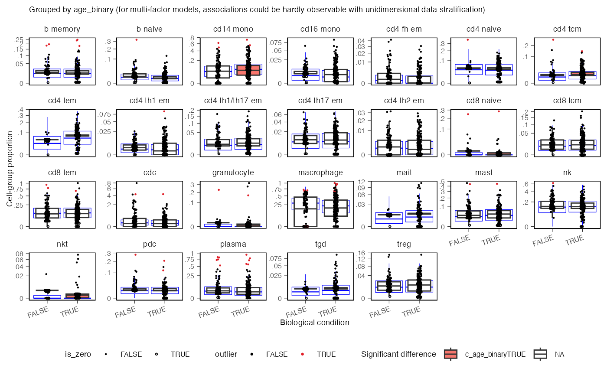

# 3. Compositional analysis

Continue from [Explore and
visualise](https://myushen.github.io/cellNexusWorkshop/articles/explore_and_visualise.md).
This article answers the question: do immune cell-type proportions
change with age? Younger and older donors from the same nine respiratory
studies are compared with `sccomp`, accounting for study (Mangiola et
al. 2023).

## Introduction to sccomp

## Keep immune cell types only

The fit uses the immune subset of `obs_lung` (`obs_composition`): one
sample-level composition over the immune types. Epithelial types are
excluded because their capture is driven by dissociation protocol as
much as by biology, and including them would move the denominator of
every immune proportion.

``` r
obs_composition <- obs_lung |>
  dplyr::filter(cell_type_unified_ensemble %in% immune_cell_types) |>
  # sccomp stores covariates in one column. A logical cannot share that
  # column with a character study id. "FALSE" is the reference level.
  dplyr::mutate(age_binary = as.character(age_binary))

obs_composition |>
  dplyr::count(cell_type_unified_ensemble, name = "n_cells") |>
  dplyr::arrange(dplyr::desc(n_cells))
```

    ## # A tibble: 26 × 2
    ##    cell_type_unified_ensemble n_cells
    ##    <chr>                        <int>
    ##  1 macrophage                  196975
    ##  2 cd14 mono                    45990
    ##  3 nk                           37230
    ##  4 cd8 tem                      34201
    ##  5 plasma                       23810
    ##  6 cdc                          13773
    ##  7 mast                         13578
    ##  8 cd4 th1/th17 em               7122
    ##  9 cd8 tcm                       5680
    ## 10 treg                          5368
    ## # ℹ 16 more rows

## Test whether immune proportions change with age

The formula is `~ age_binary + dataset_id`. `sample_id` is the
replicate. `cell_type_unified_ensemble` is the group. `dataset_id` is a
fixed effect, so the age contrast is within study.

`bimodal_mean_variability_association = TRUE` lets rare and abundant
cell types follow different variability regimes.

This fit uses Hamiltonian Monte Carlo (`inference_method = "hmc"`). The
first call compiles the Stan model. Read the sampler diagnostics on the
fit before you quote an effect.

``` r
sccomp_res <- obs_composition |>
  sccomp_estimate(
    formula_composition = ~ age_binary + dataset_id,
    sample = "sample_id",
    cell_group = "cell_type_unified_ensemble",
    bimodal_mean_variability_association = TRUE,
    inference_method = "hmc",
    output_directory = "/vast/scratch/users/shen.m/sccomp_draws_files",
    cache_stan_model = "/vast/scratch/users/shen.m/"
  ) |>
  sccomp_remove_outliers(output_directory = "/vast/scratch/users/shen.m/sccomp_draws_files",
                         cache_stan_model = "/vast/scratch/users/shen.m/") |>
  sccomp_test()
```

Outlier removal refits the model with aberrant samples down-weighted.
Removal comes before the test, because the test reads the refitted
model. Look at which samples were flagged before accepting the
correction. A flag concentrated in one study is a finding of its own.

``` r
sccomp_res |>
  dplyr::filter(factor == "age_binary") |>
  dplyr::select(cell_type_unified_ensemble, dplyr::starts_with("c_"), c_FDR)
```

    ## sccomp model
    ## ============
    ## 
    ## Model specifications:
    ##   Family: multi_beta_binomial 
    ##   Composition formula: ~age_binary + dataset_id 
    ##   Variability formula: ~1 
    ##   Inference method: hmc 
    ## 
    ## Data: Samples: 327   Cell groups: 26 
    ## 
    ## Column prefixes: c_ -> composition parameters  v_ -> variability parameters
    ## 
    ## Convergence diagnostics:
    ##   For each parameter, n_eff is the effective sample size and R_k_hat is the potential
    ##   scale reduction factor on split chains (at convergence, R_k_hat = 1).
    ## 
    ## # A tibble: 26 × 9
    ##    cell_type_unified_ensemble c_lower c_effect c_upper   c_pH0   c_FDR c_rhat
    ##    <chr>                        <dbl>    <dbl>   <dbl>   <dbl>   <dbl>  <dbl>
    ##  1 b memory                   -0.281   0.0398    0.360 0.641   0.241     1.00
    ##  2 b naive                    -0.567  -0.225     0.119 0.237   0.0889    1.00
    ##  3 cd14 mono                   0.114   0.351     0.584 0.0190  0.00701   1.00
    ##  4 cd16 mono                  -0.359   0.00379   0.369 0.690   0.300     1.00
    ##  5 cd4 fh em                  -0.281   0.105     0.489 0.497   0.200     1.00
    ##  6 cd4 naive                  -0.317   0.0271    0.370 0.659   0.262     1.00
    ##  7 cd4 tcm                     0.0285  0.383     0.757 0.0611  0.0249    1.00
    ##  8 cd4 tem                     0.199   0.724     1.32  0.00701 0.00300   1.00
    ##  9 cd4 th1 em                 -0.311   0.0227    0.361 0.677   0.282     1.00
    ## 10 cd4 th1/th17 em            -0.0667  0.236     0.541 0.194   0.0741    1.00
    ## # ℹ 16 more rows
    ## # ℹ 2 more variables: c_ess_bulk <dbl>, c_ess_tail <dbl>

Columns whose names start with `c_` carry the age effect, its interval,
`c_FDR`, and sampler diagnostics. On an HMC fit, `c_rhat` near 1 and a
large effective sample size are the checks you want. The effect is on
the model’s composition scale.

An effect is a change in share. Because shares sum to one, one real
change produces mirror-image changes in other labels. The label set is
part of the result: this fit is a shift inside the immune compartment.

## Compare observed and modelled proportions

`age_binary` has two levels, so the summary is a boxplot.
`remove_unwanted_effects = TRUE` shows proportions after the study term
has been regressed out, which is the visual counterpart of the
within-study age contrast. The blue box is the posterior predictive
check (Gabry et al. 2019): the distribution of data the model would
produce. Overlap between the observed points and that distribution is
evidence that the model describes these data.

``` r
sccomp_boxplot(
  sccomp_res,
  factor = "age_binary",
  significance_threshold = 0.05,
  remove_unwanted_effects = TRUE,
  cache_stan_model = "/vast/scratch/users/shen.m/"
)
```



> **Exercise 6.** Which cell types have `c_FDR < 0.05` for
> `factor == "age_binary"`? For each, is the estimated effect higher or
> lower in donors over 50?

Solution

``` r
sccomp_res |>
  dplyr::filter(factor == "age_binary", c_FDR < 0.05) |>
  dplyr::select(cell_type_unified_ensemble, dplyr::starts_with("c_"), c_FDR)
```

Read the sign of the effect column together with the boxplot. The
contrast is donors over 50 against the reference level `"FALSE"` (50 and
under), because `age_binary` was stored as character with `"FALSE"`
first.

Next: [Gene
expression](https://myushen.github.io/cellNexusWorkshop/articles/gene_expression.md).
