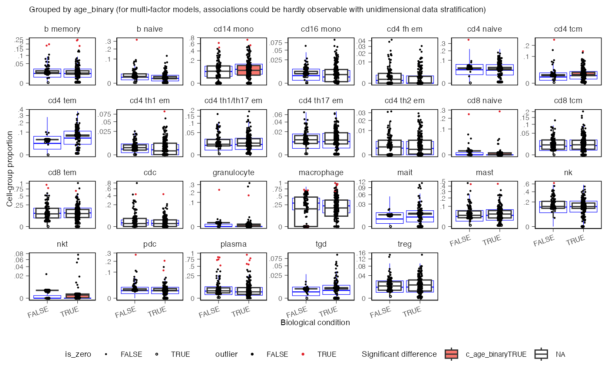

# 3. Compositional analysis

Continue in the same session. This block fits a donor-level model of
immune cell-type proportions with `sccomp` (Mangiola et al. 2023).

``` r

library(dplyr)
library(cellNexusWorkshop)
library(sccomp)

if (!exists("obs_lung")) {
  library(cellNexus)
  dataset_ids <- respiratory_dataset_ids()
  cell_types_query <- c(immune_cell_types(), epithelial_cell_types())
  obs_lung <- get_metadata() |>
    keep_quality_cells() |>
    dplyr::filter(
      dataset_id %in% dataset_ids,
      cell_type_unified_ensemble %in% cell_types_query,
      age_days >= 365,
      age_days < 80 * 365
    ) |>
    join_census_tissue() |>
    annotate_cell_nexus(min_cells_per_sample = 50)
}
```

## Why a composition model

This step quantifies age-associated shifts in **cell-type composition**
on the immune subset of `obs_lung` (`obs_composition`): one donor-level
simplex per sample over the immune types of the **same nine respiratory
studies**. Epithelial types are excluded here because their capture is
driven by dissociation protocol as much as by biology, and including
them would move the denominator of every immune proportion. **Pseudobulk
DE** and UMAP validation filter the full table to `epithelial` instead.

``` r

obs_composition <- obs_lung |>
  dplyr::filter(cell_type_unified_ensemble %in% immune_cell_types()) |>
  # sccomp stores covariates in one column. A logical cannot share that
  # column with a character study id. "FALSE" is the reference level.
  dplyr::mutate(age_binary = as.character(age_binary))

obs_composition |>
  dplyr::count(cell_type_unified_ensemble, name = "n_cells") |>
  dplyr::arrange(dplyr::desc(n_cells))
```

    ## # A tibble: 26 × 2
    ##    cell_type_unified_ensemble n_cells
    ##    <chr>                        <int>
    ##  1 macrophage                  196975
    ##  2 cd14 mono                    45990
    ##  3 nk                           37230
    ##  4 cd8 tem                      34201
    ##  5 plasma                       23810
    ##  6 cdc                          13773
    ##  7 mast                         13578
    ##  8 cd4 th1/th17 em               7122
    ##  9 cd8 tcm                       5680
    ## 10 treg                          5368
    ## # ℹ 16 more rows

## Fit

The formula is `~ age_binary + dataset_id`. `sample_id` is the
replicate. `cell_type_unified_ensemble` is the group. `dataset_id` is a
fixed effect, so the age contrast is within study.

`bimodal_mean_variability_association = TRUE` lets rare and abundant
cell types follow different variability regimes.

The session default is `pathfinder`, which is fast enough to finish in
the room. A result you would report uses Hamiltonian Monte Carlo
(`inference_method = "hmc"`). Pathfinder intervals are a working
approximation. Refit with `"hmc"` before you quote an effect, and read
the sampler diagnostics on that fit. Set
`CELLNEXUS_WORKSHOP_INFERENCE=hmc` for that fit. The first call compiles
the Stan model and can take several minutes on top of the fit.

``` r

inference_method <- Sys.getenv("CELLNEXUS_WORKSHOP_INFERENCE", "pathfinder")

sccomp_res <- obs_composition |>
  sccomp_estimate(
    formula_composition = ~ age_binary + dataset_id,
    sample = "sample_id",
    cell_group = "cell_type_unified_ensemble",
    bimodal_mean_variability_association = TRUE,
    inference_method = inference_method,
    output_directory = "/vast/scratch/users/shen.m/sccomp_draws_files",
    cache_stan_model = "/vast/scratch/users/shen.m/"
  ) |>
  sccomp_remove_outliers(output_directory = "/vast/scratch/users/shen.m/sccomp_draws_files",
                         cache_stan_model = "/vast/scratch/users/shen.m/") |>
  sccomp_test()
```

Outlier removal refits the model with aberrant samples down-weighted.
Removal comes before the test, because the test reads the refitted
model. Look at which samples were flagged before accepting the
correction. A flag concentrated in one study is a finding of its own.

``` r

sccomp_res |>
  dplyr::filter(factor == "age_binary") |>
  dplyr::select(cell_type_unified_ensemble, dplyr::starts_with("c_"), c_FDR)
```

    ## sccomp model
    ## ============
    ## 
    ## Model specifications:
    ##   Family: multi_beta_binomial 
    ##   Composition formula: ~age_binary + dataset_id 
    ##   Variability formula: ~1 
    ##   Inference method: pathfinder 
    ## 
    ## Data: Samples: 327   Cell groups: 26 
    ## 
    ## Column prefixes: c_ -> composition parameters  v_ -> variability parameters
    ## 
    ## Convergence diagnostics:
    ##   For each parameter, n_eff is the effective sample size and R_k_hat is the potential
    ##   scale reduction factor on split chains (at convergence, R_k_hat = 1).
    ## 
    ## # A tibble: 26 × 9
    ##    cell_type_unified_ensemble c_lower  c_effect c_upper    c_pH0    c_FDR c_rhat
    ##    <chr>                        <dbl>     <dbl>   <dbl>    <dbl>    <dbl>  <dbl>
    ##  1 b memory                   -0.108   0.105     0.331  0.487    0.175     1.00 
    ##  2 b naive                    -0.407  -0.185     0.0425 0.233    0.0894    1.00 
    ##  3 cd14 mono                   0.152   0.362     0.572  0.0100   0.00210   1.000
    ##  4 cd16 mono                  -0.296  -0.0502    0.193  0.660    0.251     1.000
    ##  5 cd4 fh em                  -0.306  -0.0198    0.267  0.717    0.272     1.00 
    ##  6 cd4 naive                  -0.142   0.0741    0.287  0.593    0.213     1.00 
    ##  7 cd4 tcm                     0.136   0.357     0.569  0.0105   0.00350   1.00 
    ##  8 cd4 tem                     0.354   0.601     0.859  0.000500 0.000125  1.00 
    ##  9 cd4 th1 em                 -0.235   0.000630  0.233  0.800    0.327     1.00 
    ## 10 cd4 th1/th17 em            -0.0424  0.174     0.374  0.234    0.100     1.00 
    ## # ℹ 16 more rows
    ## # ℹ 2 more variables: c_ess_bulk <dbl>, c_ess_tail <dbl>

Columns whose names start with `c_` carry the age effect, its interval,
`c_FDR`, and sampler diagnostics. On an HMC fit, `c_rhat` near 1 and a
large effective sample size are the checks you want. The effect is on
the model’s composition scale.

An effect is a change in share. Because shares sum to one, one real
change produces mirror-image changes in other labels. The label set is
part of the result: this fit is a shift inside the immune compartment.

## Plot

`age_binary` has two levels, so the summary is a boxplot.
`remove_unwanted_effects = TRUE` shows proportions after the study term
has been regressed out, which is the visual counterpart of the model.
The blue box is the posterior predictive check (Gabry et al. 2019): the
distribution of data the model would produce. Overlap between the
observed points and that distribution is evidence that the model
describes these data.

``` r

sccomp_boxplot(
  sccomp_res,
  factor = "age_binary",
  significance_threshold = 0.05,
  remove_unwanted_effects = TRUE,
  cache_stan_model = "/vast/scratch/users/shen.m/"
)
```

    ## Running standalone generated quantities after 1 MCMC chain, with 1 thread(s) per chain...
    ## 
    ## Chain 1  Elapsed Time: 10.329 seconds (Generated Quantities) 
    ## Chain 1 finished in 0.0 seconds.

    ## Running standalone generated quantities after 1 MCMC chain, with 1 thread(s) per chain...
    ## 
    ## Chain 1  Elapsed Time: 10.7 seconds (Generated Quantities) 
    ## Chain 1 finished in 0.0 seconds.

    ## Running standalone generated quantities after 1 MCMC chain, with 1 thread(s) per chain...
    ## 
    ## Chain 1  Elapsed Time: 2.094 seconds (Generated Quantities) 
    ## Chain 1 finished in 0.0 seconds.



> **Exercise 6.** Which cell types have `c_FDR < 0.05` for
> `factor == "age_binary"`? For each, is the estimated effect higher or
> lower in donors over 50?

Solution

``` r

sccomp_res |>
  dplyr::filter(factor == "age_binary", c_FDR < 0.05) |>
  dplyr::select(cell_type_unified_ensemble, dplyr::starts_with("c_"), c_FDR)
```

Read the sign of the effect column together with the boxplot. The
contrast is donors over 50 against the reference level `"FALSE"` (50 and
under), because `age_binary` was stored as character with `"FALSE"`
first.

Next: [Gene
expression](https://myushen.github.io/cellNexusWorkshop/articles/gene_expression.md).
