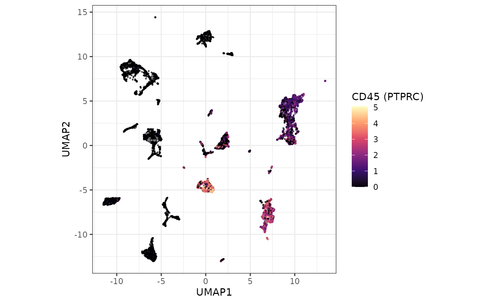

# 2. Explore and visualise

Continue in the session from [Query the
atlas](https://myushen.github.io/cellNexusWorkshop/articles/query_the_atlas.md).
`obs_lung` already holds the respiratory cohort: nine Human Cell Atlas
studies, with donor age and harmonised cell-type labels.

This article asks whether those cells separate into the immune and
epithelial compartments the later models use. You download a
SingleCellExperiment, explore it with the `tidyomics` packages, and
integrate the studies with Harmony. Immune cells should sit apart from
epithelial cells on the UMAP, and CD45 should mark that split
independently of the harmonised label. The same cells are then shown as
a Seurat object.

## Download counts for the cohort

`get_single_cell_experiment()` reads the count matrices for the cells in
`obs_lung` and returns one `SingleCellExperiment`. Cells are subsampled
within sample, and the number of samples is capped, so a few large
libraries do not dominate the highly variable genes. The download is
capped at 12,000 cells, and one sample does not exceed 100 cells.

``` r
max_cells_qc <- 12000L
cells_per_sample_qc <- 100L
n_samples_qc <- 120L

set.seed(42)
samples_qc <- dplyr::distinct(obs_lung, sample_id)
samples_qc <- dplyr::slice_sample(samples_qc, n = min(n_samples_qc, nrow(samples_qc)))

sampled_qc <- obs_lung |>
  dplyr::semi_join(samples_qc, by = "sample_id") |>
  dplyr::group_by(sample_id) |>
  dplyr::slice(sample.int(dplyr::n(), min(cells_per_sample_qc, dplyr::n()))) |>
  dplyr::ungroup()

# Compiling the object takes about 8 minutes.
sce_qc <- sampled_qc |>
  get_single_cell_experiment(assays = "counts")
sce_qc
```

Building `sce_qc` takes about 10 minutes. The counts are written to
`inst/extdata/sce_qc.rds` before log-normalisation. Load the file if
time is short.

``` r
sce_qc <- logNormCounts(sce_qc)
```

With `tidySingleCellExperiment` loaded, the object prints as a tibble
and accepts `dplyr` verbs and `ggplot2`. The underlying assay is
unchanged.

``` r
sce_qc |>
  dplyr::count(cell_type_unified_ensemble, sort = TRUE)
```

    ## # A tibble: 29 × 2
    ##    cell_type_unified_ensemble     n
    ##    <chr>                      <int>
    ##  1 epithelial                  2767
    ##  2 pneumocyte                  2706
    ##  3 macrophage                  2466
    ##  4 cd14 mono                    604
    ##  5 nk                           590
    ##  6 secretory                    562
    ##  7 cd8 tem                      537
    ##  8 plasma                       307
    ##  9 mast                         198
    ## 10 cdc                          167
    ## # ℹ 19 more rows

## Integrate studies and check the split with CD45

This section asks whether immune and epithelial cells occupy different
regions once study is removed from the embedding. Highly variable genes
are selected per sample (`modelGeneVar(block = sample_id)`), so genes
that vary within a donor rank above genes that merely differ between
libraries (Lun, McCarthy, and Marioni 2016). Harmony then removes the
study axis from the PCA (Korsunsky et al. 2019). The UMAP is drawn from
that embedding.

CD45 (`PTPRC`, Ensembl `ENSG00000081237`) marks haematopoietic cells
independently of the harmonised label. After Harmony, immune cells
should sit in the high-CD45 region and epithelial cells in the low-CD45
region.

``` r
hvgs_qc <- sce_qc |>
  modelGeneVar(block = sce_qc$sample_id) |>
  getTopHVGs(n = 2000)

sce_qc <- sce_qc |>
  runPCA(ncomponents = 30, subset_row = hvgs_qc) |>
  RunHarmony(
    group.by.vars = "dataset_id",
    dims.use = 1:30,
    verbose = FALSE,
    reduction.save = "HARMONY"
  ) |>
  runUMAP(dimred = "HARMONY", n_neighbors = 15)

cd45_id <- "ENSG00000081237" # Ensemble ID for PTPRC

sce_cd45 <- sampled_qc |>
  get_single_cell_experiment(assays = "counts", features = cd45_id) 

sce_qc$cd45 <- NA_real_
i <- match(colnames(sce_qc), colnames(sce_cd45))
sce_qc$cd45[!is.na(i)] <- log1p(
  as.numeric(SummarizedExperiment::assay(sce_cd45, "counts")[1, i[!is.na(i)]])
)

#base::saveRDS(sce_qc,"./cellNexusWorkshop/inst/extdata/sce_qc_batch_corrected.rds", compress="xz")
```

``` r
sce_qc |>
  ggplot(aes(UMAP1, UMAP2, colour = cd45)) +
  geom_point(size = 0.3, alpha = 0.6) +
  scale_colour_viridis_c(option = "magma") +
  coord_equal() +
  theme_bw() +
  labs(colour = "CD45 (PTPRC)")
```



> **Exercise 4.** Colour the same UMAP by `dataset_id`.

Solution

``` r
sce_qc |>
  ggplot2::ggplot(ggplot2::aes(UMAP1, UMAP2, colour = dataset_id)) +
  ggplot2::geom_point(size = 0.3, alpha = 0.6) +
  ggplot2::coord_equal() +
  ggplot2::theme_bw()
```

> **Exercise 5.** Using `sce_qc`, count cells per
> `cell_type_unified_ensemble`. Which of `immune_cell_types` are missing
> from this subsample?

Solution

``` r
sce_qc |>
  dplyr::count(cell_type_unified_ensemble, sort = TRUE)

setdiff(immune_cell_types, unique(sce_qc$cell_type_unified_ensemble))
```

## Open the same table as a Seurat object

`get_seurat()` reads the same metadata table into a Seurat object.
`tidyseurat` gives that object the tibble interface you just used on the
SingleCellExperiment. The rest of the workshop stays with
SingleCellExperiment. This demo reads 100 cells from one study.

``` r
library(tidyseurat)

one_study <- obs_lung |>
  dplyr::filter(dataset_id == dplyr::first(dataset_id)) |>
  dplyr::slice_head(n = 100)

seurat_demo <- one_study |>
  get_seurat(assays = "counts")

seurat_demo
```

    ## # A Seurat-tibble abstraction: 100 × 28
    ## # Features=33145 | Cells=100 | Active assay=counts | Assays=counts
    ##    .cell orig.ident nCount_originalexp nFeature_originalexp dataset_id sample_id
    ##    <chr> <fct>                   <dbl>                <int> <chr>      <chr>    
    ##  1 495_1 SeuratPro…              9963.                  426 093d3bfe_… 02ba81d9…
    ##  2 569_2 SeuratPro…              9985.                  566 093d3bfe_… 02ba81d9…
    ##  3 924_3 SeuratPro…              9974.                 1531 093d3bfe_… 02ba81d9…
    ##  4 913_3 SeuratPro…              9961.                 1771 093d3bfe_… 02ba81d9…
    ##  5 899_3 SeuratPro…              9975.                 2122 093d3bfe_… 02ba81d9…
    ##  6 909_3 SeuratPro…              9954.                 1008 093d3bfe_… 02ba81d9…
    ##  7 902_3 SeuratPro…              9953.                 1700 093d3bfe_… 02ba81d9…
    ##  8 921_3 SeuratPro…              9976.                 2089 093d3bfe_… 02ba81d9…
    ##  9 2273… SeuratPro…             10000.                  519 093d3bfe_… 02ba81d9…
    ## 10 2418… SeuratPro…              9970.                  548 093d3bfe_… 02ba81d9…
    ## # ℹ 90 more rows
    ## # ℹ 22 more variables: donor_id <chr>, atlas_id <chr>, age_days <int>,
    ## #   cell_type_unified_ensemble <chr>, file_id_cellNexus_single_cell <chr>,
    ## #   file_id_cellNexus_pseudobulk <chr>, ethnicity_flagging_score <dbl>,
    ## #   low_confidence_ethnicity <chr>, imputed_ethnicity <chr>, tissue <fct>,
    ## #   self_reported_ethnicity <fct>, cell_type <fct>, assay <fct>, disease <fct>,
    ## #   sex <fct>, age_years <dbl>, age_binary <lgl>, age_bin <fct>, …

Next: [Compositional
analysis](https://myushen.github.io/cellNexusWorkshop/articles/compositional_analysis.md).
