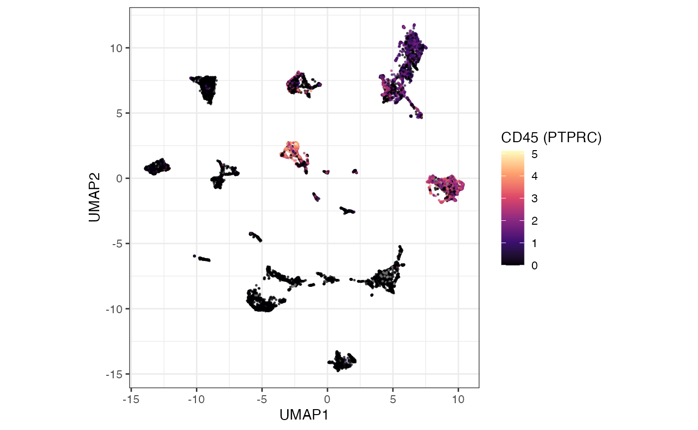
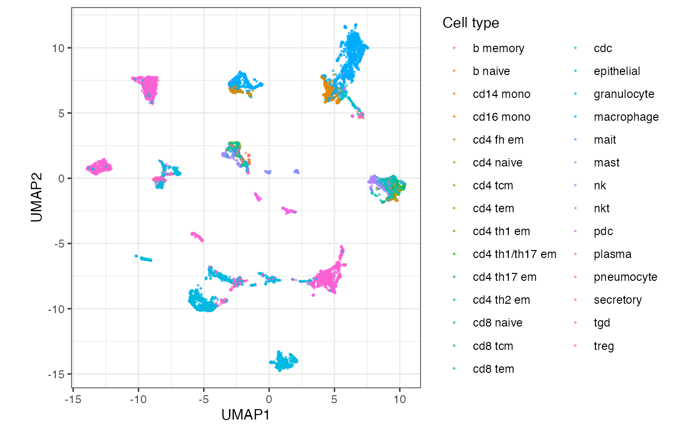

# 2. Explore and visualise

Continue in the session from [Query the
atlas](https://myushen.github.io/cellNexusWorkshop/articles/query_the_atlas.md).
This block downloads a capped SingleCellExperiment, checks that immune
and epithelial cells separate, and shows the same cells as a Seurat
object.

``` r

library(cellNexus)
library(cellNexusWorkshop)
library(dplyr)
library(ggplot2)
library(scater)
library(scran)
library(harmony)
library(SingleCellExperiment)
library(tidySingleCellExperiment)

if (!exists("obs_lung")) {
  dataset_ids <- respiratory_dataset_ids()
  cell_types_query <- c(immune_cell_types(), epithelial_cell_types())
  obs_lung <- get_metadata() |>
    keep_quality_cells() |>
    dplyr::filter(
      dataset_id %in% dataset_ids,
      cell_type_unified_ensemble %in% cell_types_query,
      age_days >= 365,
      age_days < 80 * 365
    ) |>
    join_census_tissue() |>
    annotate_cell_nexus(min_cells_per_sample = 50)
}
```

## Download a SingleCellExperiment

[`get_single_cell_experiment()`](https://mangiolalaboratory.github.io/cellNexus/reference/get_single_cell_experiment.html)
reads the count matrices for the cells in a metadata table and returns
one `SingleCellExperiment`. The workshop cap keeps the download inside a
session. The example figures on this site use 12,000 cells. Set
`CELLNEXUS_WORKSHOP_MAX_CELLS=12000` before this chunk to match them.

Cells are subsampled within sample, and the number of samples is capped,
so a few large libraries do not dominate the highly variable genes.

``` r

max_cells_qc <- as.integer(Sys.getenv("CELLNEXUS_WORKSHOP_MAX_CELLS", "4000"))
cells_per_sample_qc <- 80L
n_samples_qc <- max(1L, max_cells_qc %/% cells_per_sample_qc)

set.seed(42)
samples_qc <- dplyr::distinct(obs_lung, sample_id)
samples_qc <- dplyr::slice_sample(samples_qc, n = min(n_samples_qc, nrow(samples_qc)))

sampled_qc <- obs_lung |>
  dplyr::semi_join(samples_qc, by = "sample_id") |>
  dplyr::group_by(sample_id) |>
  dplyr::slice(sample.int(dplyr::n(), min(cells_per_sample_qc, dplyr::n()))) |>
  dplyr::ungroup()

sce_qc <- sampled_qc |>
  get_single_cell_experiment(assays = "counts") |>
  logNormCounts()

sce_qc
```

    ## # A SingleCellExperiment-tibble abstraction: 11,987 x 46
    ## # Features=16315 | Cells=11987 | Assays=counts, logcounts
    ##    .cell observation_joinid dataset_id sample_id donor_id feature_count age_days
    ##    <chr> <chr>              <chr>      <chr>     <chr>            <int>    <int>
    ##  1 29_1  C2v>l0_YWj         2adb1f8a_~ fbd957e8~ Donor23          26405    16790
    ##  2 699_2 eb&0;%#_?D         093d3bfe_~ 0ce45088~ A40              33145    23360
    ##  3 638_2 dK=2kQdg$k         093d3bfe_~ 5b82978f~ A48              33145    23542
    ##  4 632_2 VPz4bhv{Kg         093d3bfe_~ 5ee73982~ A37              33145    21535
    ##  5 645_2 rqQvRvB{Of         093d3bfe_~ 5ee73982~ A37              33145    21535
    ##  6 650_2 PwHXYWv74~         093d3bfe_~ 5ee73982~ A37              33145    21535
    ##  7 283_2 3<IN)dSug5         093d3bfe_~ 60197164~ A26              33145    27375
    ##  8 288_2 yiwH8cN91Z         093d3bfe_~ 60197164~ A26              33145    27375
    ##  9 289_2 vVY?$M0^J8         093d3bfe_~ 60197164~ A26              33145    27375
    ## 10 129_2 cK(Q>qOqbP         093d3bfe_~ 67aafc07~ A37              33145    21535
    ## # i 11,977 more rows
    ## # i 39 more variables: nFeature_expressed_in_sample <int>, nCount_RNA <dbl>,
    ## #   empty_droplet <lgl>, cell_type_unified_ensemble <chr>, is_immune <lgl>,
    ## #   subsets_Mito_percent <int>, subsets_Ribo_percent <int>,
    ## #   high_mitochondrion <lgl>, high_ribosome <lgl>, alive <lgl>,
    ## #   scDblFinder.class <chr>, file_id_cellNexus_single_cell <chr>,
    ## #   file_id_cellNexus_pseudobulk <chr>, count_upper_bound <dbl>, ...

With `tidySingleCellExperiment` loaded, the object prints as a tibble
and accepts `dplyr` verbs and `ggplot2`. The underlying assay is
unchanged.

``` r

sce_qc |>
  dplyr::count(cell_type_unified_ensemble, sort = TRUE)
```

    ## # A tibble: 29 x 2
    ##    cell_type_unified_ensemble     n
    ##    <chr>                      <int>
    ##  1 pneumocyte                  2899
    ##  2 epithelial                  2656
    ##  3 macrophage                  2378
    ##  4 cd14 mono                    653
    ##  5 cd8 tem                      582
    ##  6 nk                           559
    ##  7 secretory                    527
    ##  8 plasma                       342
    ##  9 cdc                          197
    ## 10 mast                         186
    ## # i 19 more rows

## Integrate studies and colour by CD45

Highly variable genes are selected per sample
(`modelGeneVar(block = sample_id)`), so genes that vary within a donor
rank above genes that merely differ between libraries (Lun et al. 2016).
Harmony then removes the study axis from the PCA (Korsunsky et al.
2019). The UMAP is drawn from that embedding.

CD45 (`PTPRC`, Ensembl `ENSG00000081237`) marks haematopoietic cells
independently of the harmonised label. After Harmony, immune cells
should sit in the high-CD45 region and epithelial cells in the low-CD45
region.

``` r

hvgs_qc <- sce_qc |>
  modelGeneVar(block = sce_qc$sample_id) |>
  getTopHVGs(n = 2000)

sce_qc <- sce_qc |>
  runPCA(ncomponents = 30, subset_row = hvgs_qc) |>
  RunHarmony(
    group.by.vars = "dataset_id",
    dims.use = 1:30,
    verbose = FALSE,
    reduction.save = "HARMONY"
  ) |>
  runUMAP(dimred = "HARMONY", n_neighbors = 15)

cd45_id <- c(
  grep("^ENSG00000081237(\\.|$)", rownames(sce_qc), value = TRUE),
  intersect("PTPRC", rownames(sce_qc))
)

if (length(cd45_id)) {
  sce_qc$cd45 <- as.numeric(logcounts(sce_qc)[cd45_id[[1]], ])
} else {
  sce_cd45 <- sampled_qc |>
    get_single_cell_experiment(assays = "counts", features = "ENSG00000081237")
  sce_qc$cd45 <- NA_real_
  i <- match(colnames(sce_qc), colnames(sce_cd45))
  sce_qc$cd45[!is.na(i)] <- log1p(
    as.numeric(SummarizedExperiment::assay(sce_cd45, "counts")[1, i[!is.na(i)]])
  )
  rm(sce_cd45)
}
```

``` r

sce_qc |>
  ggplot(aes(UMAP1, UMAP2, colour = cd45)) +
  geom_point(size = 0.3, alpha = 0.6) +
  scale_colour_viridis_c(option = "magma") +
  coord_equal() +
  theme_bw() +
  labs(colour = "CD45 (PTPRC)")
```




Example Harmony UMAP, coloured by CD45. Immune cells occupy the
high-CD45 region and epithelial cells the low-CD45 region.

The same grammar colours the embedding by the harmonised label.

``` r

sce_qc |>
  ggplot(aes(UMAP1, UMAP2, colour = cell_type_unified_ensemble)) +
  geom_point(size = 0.3, alpha = 0.6) +
  coord_equal() +
  theme_bw() +
  labs(colour = "Cell type")
```



> **Exercise 4.** Colour the same UMAP by `dataset_id`. After Harmony,
> study identity should be mixed within a cell-type region. Islands that
> follow study boundaries are under-correction. Harmony adjusts the
> embedding used for the picture. It does not adjust the counts, so the
> models in the next two articles still include `dataset_id`.

Solution

``` r

sce_qc |>
  ggplot2::ggplot(ggplot2::aes(UMAP1, UMAP2, colour = dataset_id)) +
  ggplot2::geom_point(size = 0.3, alpha = 0.6) +
  ggplot2::coord_equal() +
  ggplot2::theme_bw()
```

Mixing of colours inside a cell-type region is the pattern you want
after Harmony. A region painted by a single study is under-correction.
The expression model still includes `dataset_id`, because the counts
were not adjusted.

> **Exercise 5.** Using `sce_qc`, count cells per
> `cell_type_unified_ensemble`. Which of
> [`immune_cell_types()`](https://myushen.github.io/cellNexusWorkshop/reference/immune_cell_types.md)
> are missing from this subsample, and what does that imply for a
> composition estimate built from these cells alone?

Solution

``` r

library(cellNexusWorkshop)

sce_qc |>
  dplyr::count(cell_type_unified_ensemble, sort = TRUE)

setdiff(immune_cell_types(), unique(sce_qc$cell_type_unified_ensemble))
```

Labels missing from this subsample are absent because of the cap, not
because they are absent from `obs_lung`. Composition in the next article
is fit on `obs_lung`, which keeps every cell of every retained sample.
Fitting `sccomp` on `sce_qc` would estimate the subsample.

## The same cells as a Seurat object

[`get_seurat()`](https://mangiolalaboratory.github.io/cellNexus/reference/get_seurat.html)
is
[`get_single_cell_experiment()`](https://mangiolalaboratory.github.io/cellNexus/reference/get_single_cell_experiment.html)
followed by the Seurat conversion. Pass a small metadata table. A
handful of cells spread across many files downloads a handful of files.

``` r

library(tidyseurat)

one_study <- obs_lung |>
  dplyr::filter(dataset_id == dplyr::first(dataset_id)) |>
  dplyr::slice_head(n = 100)

seurat_demo <- one_study |>
  get_seurat(assays = "counts")

seurat_demo
```

    ## # A Seurat-tibble abstraction: 100 x 50
    ## # Features=33145 | Cells=100 | Active assay=counts | Assays=counts
    ##    .cell  orig.ident  nCount_originalexp nFeature_originalexp observation_joinid
    ##    <chr>  <fct>                    <dbl>                <int> <chr>             
    ##  1 495_1  SeuratProj~              9963.                  426 )>te!b8pEJ        
    ##  2 569_2  SeuratProj~              9985.                  566 %=xI5jRY4?        
    ##  3 924_3  SeuratProj~              9974.                 1531 !`&!Q3~>-J        
    ##  4 913_3  SeuratProj~              9961.                 1771 $xhxN?oF#O        
    ##  5 899_3  SeuratProj~              9975.                 2122 $|c|J0Wj}b        
    ##  6 909_3  SeuratProj~              9954.                 1008 %E}fsQ09Os        
    ##  7 902_3  SeuratProj~              9953.                 1700 *^ZXM4fn=C        
    ##  8 921_3  SeuratProj~              9976.                 2089 +}>sX{6y5h        
    ##  9 2273_4 SeuratProj~             10000.                  519 !2%6tGB!1M        
    ## 10 2418_4 SeuratProj~              9970.                  548 #hf4{^>7WI        
    ## # i 90 more rows
    ## # i 45 more variables: dataset_id <chr>, sample_id <chr>, donor_id <chr>,
    ## #   feature_count <int>, age_days <int>, nFeature_expressed_in_sample <int>,
    ## #   nCount_RNA <dbl>, empty_droplet <lgl>, cell_type_unified_ensemble <chr>,
    ## #   is_immune <lgl>, subsets_Mito_percent <int>, subsets_Ribo_percent <int>,
    ## #   high_mitochondrion <lgl>, high_ribosome <lgl>, alive <lgl>,
    ## #   scDblFinder.class <chr>, file_id_cellNexus_single_cell <chr>, ...

`tidyseurat` gives that object the same tibble interface you just used
on the SingleCellExperiment. The rest of the workshop stays with
SingleCellExperiment, because the pseudobulk tools speak that language.

Next: [Compositional
analysis](https://myushen.github.io/cellNexusWorkshop/articles/compositional_analysis.md).
