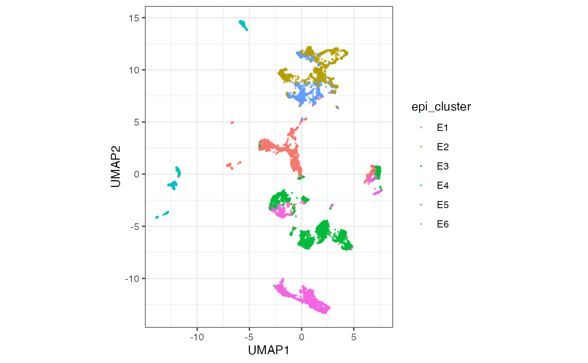
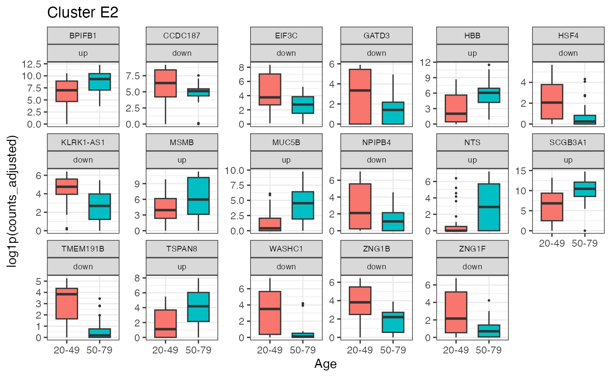
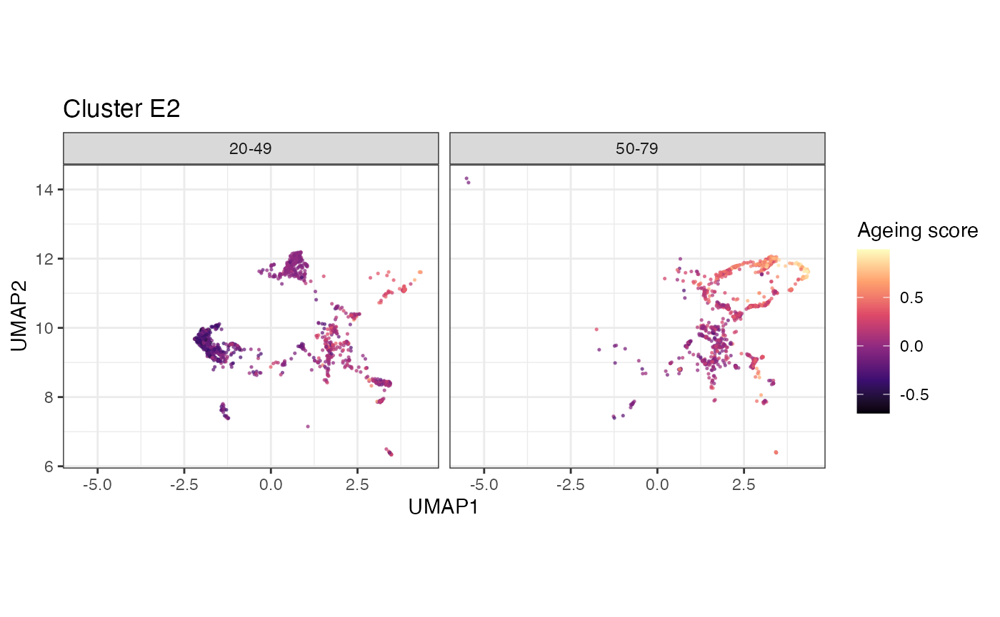
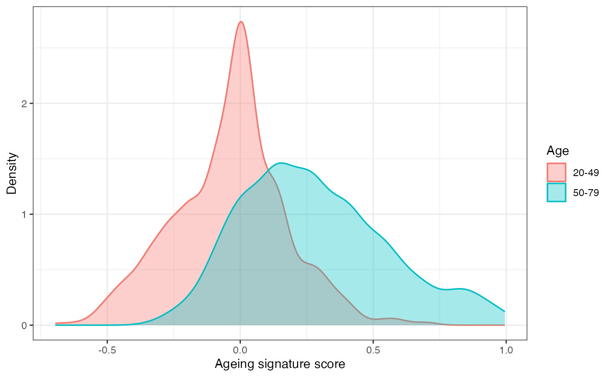

# 4. Gene expression

Continue in the same session. This block integrates epithelial cells,
aggregates sample-by-cluster pseudobulk, and tests donor-level age
effects with DESeq2 through tidybulk (Love et al. 2014). The last
section scores the resulting signature back onto single cells (Foroutan
et al. 2018).

The reusable script for everything you have run is installed with the
package:

``` r

file.edit(system.file(
  "scripts", "workshop_respiratory_ageing.R",
  package = "cellNexusWorkshop"
))
```

``` r

library(cellNexus)
library(cellNexusWorkshop)
library(dplyr)
library(ggplot2)
library(scater)
library(scuttle)
library(scran)
library(scrapper)
library(bluster)
library(harmony)
library(SingleCellExperiment)
library(SummarizedExperiment)
library(Matrix)
library(tidySingleCellExperiment)
library(tidySummarizedExperiment)
library(tidybulk)
library(AnnotationDbi)
library(org.Hs.eg.db)
library(stringr)
library(DESeq2)

if (!exists("obs_lung")) {
  dataset_ids <- respiratory_dataset_ids()
  cell_types_query <- c(immune_cell_types(), epithelial_cell_types())
  obs_lung <- get_metadata() |>
    keep_quality_cells() |>
    dplyr::filter(
      dataset_id %in% dataset_ids,
      cell_type_unified_ensemble %in% cell_types_query,
      age_days >= 365,
      age_days < 80 * 365
    ) |>
    join_census_tissue() |>
    annotate_cell_nexus(min_cells_per_sample = 50)
}
```

## Integrate and cluster the epithelial compartment

The broad label `epithelial` mixes ciliated, secretory, basal, and
alveolar states. We integrate cells, cut the embedding into six
clusters, and test age inside the cluster that can support the design.

The download is capped by `CELLNEXUS_WORKSHOP_MAX_CELLS`. The example
figures use 12000 cells. Harmony here is for clustering and the UMAP.
The counts still carry study effects, and the model below still includes
`dataset_id`.

``` r

epi_cell_cap <- as.integer(Sys.getenv("CELLNEXUS_WORKSHOP_MAX_CELLS", "12000"))
min_cells_pb <- as.integer(Sys.getenv("CELLNEXUS_WORKSHOP_MIN_CELLS_PB", "10"))

set.seed(42)
epi_cells <- obs_lung |>
  dplyr::filter(cell_type_unified_ensemble == "epithelial")
epi_cells <- dplyr::slice_sample(
  epi_cells,
  n = min(epi_cell_cap, nrow(epi_cells))
)

sce_epi <- epi_cells |>
  get_single_cell_experiment(assays = "counts") |>
  logNormCounts()

hvgs <- sce_epi |>
  modelGeneVar() |>
  getTopHVGs(n = 2000)

sce_epi <- sce_epi |>
  runPCA(ncomponents = 30, subset_row = hvgs) |>
  RunHarmony(
    group.by.vars = "dataset_id",
    dims.use = 1:30,
    verbose = FALSE,
    reduction.save = "HARMONY"
  ) |>
  runUMAP(dimred = "HARMONY", n_neighbors = 15)

sce_epi$epi_cluster <- factor(paste0(
  "E",
  clusterCells(
    sce_epi,
    use.dimred = "HARMONY",
    BLUSPARAM = KmeansParam(centers = 6L)
  )
))
```

``` r

sce_epi |>
  ggplot(aes(UMAP1, UMAP2, colour = epi_cluster)) +
  geom_point(size = 0.3, alpha = 0.6) +
  coord_equal() +
  theme_bw()
```



k-means labels are arbitrary. `E1` in your session is not `E1` in the
example figure. The next section chooses the cluster from a screen,
which you report alongside the label.

## Aggregate sample-by-cluster pseudobulk

[`aggregateAcrossCells.se()`](https://rdrr.io/pkg/scrapper/man/aggregateAcrossCells.se.html)
sums raw counts within each sample and cluster. The column `ncells` is
the number of cells that entered each pseudobulk. Profiles with fewer
than 10 cells are dropped. `log_cell_count` is a scaled depth covariate
so profiles built from different numbers of cells are comparable.

``` r

pb_se <- scrapper::aggregateAcrossCells.se(
  sce_epi,
  factors = list(
    sample_id = sce_epi$sample_id,
    epi_cluster = sce_epi$epi_cluster
  ),
  counts.name = "ncells"
)

SummarizedExperiment::assayNames(pb_se)[
  SummarizedExperiment::assayNames(pb_se) == "sums"
] <- "counts"

pb_se <- pb_se |>
  dplyr::filter(ncells >= min_cells_pb) |>
  dplyr::mutate(log_cell_count = as.numeric(scale(log1p(ncells))))

pb_se
```

    ## class: RangedSummarizedExperiment 
    ## dim: 16315 239 
    ## metadata(3): aggregated latest_filter_scope_report
    ##   latest_mutate_scope_report
    ## assays(2): counts detected
    ## rownames(16315): ENSG00000144837 ENSG00000187554 ... ENSG00000120539
    ##   ENSG00000205420
    ## rowData names(0):
    ## colnames(239): 1 7 ... 775 776
    ## colData names(50): factor.sample_id factor.epi_cluster ... epi_cluster
    ##   log_cell_count

## Choose a cluster and fit the age model

[`select_de_cluster()`](https://myushen.github.io/cellNexusWorkshop/reference/select_de_cluster.md)
keeps clusters in which both age classes are represented and the design
can separate age from study. It prefers the cluster supported by the
most studies that contribute both age classes. The default screen asks
for 150 cells and 5 samples in each class. A 4000-cell cap may need the
slightly lower thresholds below. If the function stops, read the printed
screen and lower `min_samples_per_class`, or raise
`CELLNEXUS_WORKSHOP_MAX_CELLS` and rebuild `pb_se`.

``` r

de_design <- ~ age_binary + log_cell_count + dataset_id
de_contrast <- list(c("age_binary", "old", "young"))
de_log2_fold_change_threshold <- 1
de_signature_max_genes <- 25L

epi_cluster_screen <- select_de_cluster(
  pb_se,
  de_design,
  min_cells_per_class = 100L,
  min_samples_per_class = 4L
)
epi_cluster_de_top <- epi_cluster_screen$cluster
epi_cluster_screen$screen
```

    ##   epi_cluster n_pseudobulk n_cells n_cells_young n_cells_old n_samples_young
    ## 1          E2           59    1882          1054         828              31
    ## 2          E1           46    1506           933         573              27
    ## 3          E5           41     898           596         302              27
    ## 4          E3           39    3093           928        2165              18
    ## 5          E6           26    2418          2042         376              18
    ## 6          E4           28     569           184         385               8
    ##   n_samples_old n_datasets n_datasets_spanning_age frac_young  frac_old
    ## 1            28          5                       3  0.5600425 0.4399575
    ## 2            19          5                       1  0.6195219 0.3804781
    ## 3            14          3                       1  0.6636971 0.3363029
    ## 4            21          3                       1  0.3000323 0.6999677
    ## 5             8          4                       1  0.8444996 0.1555004
    ## 6            20          4                       0  0.3233743 0.6766257
    ##   full_rank eligible
    ## 1      TRUE     TRUE
    ## 2      TRUE    FALSE
    ## 3      TRUE    FALSE
    ## 4      TRUE    FALSE
    ## 5      TRUE    FALSE
    ## 6     FALSE    FALSE

> **Exercise 7.** From `epi_cluster_screen$screen`, which cluster was
> chosen? How many studies in that cluster contribute both age classes
> (`n_datasets_spanning_age`)? Quote the screen table with the result.
> The label alone is not reproducible.

Solution

``` r

epi_cluster_de_top
epi_cluster_screen$screen
```

The chosen row is the first row of the screen after eligible clusters
are sorted by `n_datasets_spanning_age`, then by the number of
pseudobulk profiles. Quote `n_datasets_spanning_age` for that row. A
value of 1 means the age term rests on a single study.

The contrast is old versus young: positive log fold changes are higher
in donors over 50. DESeq2 tests against a log2 fold change of 1, so the
p-value asks whether the change exceeds a doubling. Say that when you
report the p-values. `sfType = "poscounts"` estimates size factors on
sparse pseudobulk, where the default median-of-ratios estimator can find
no gene detected in every profile.

Genes are kept when they reach 5 counts per million in at least half of
the profiles, evaluated with respect to age, so a gene expressed in one
age class survives.

``` r

pb_se <- pb_se[, pb_se$epi_cluster == epi_cluster_de_top]
pb_se <- pb_se[, Matrix::colSums(assay(pb_se, "counts")) > 0]

assay(pb_se, "counts") <- round(assay(pb_se, "counts"))
pb_se$sizeFactor <- NULL

pb_se$age_binary <- factor(
  ifelse(pb_se$age_binary, "old", "young"),
  levels = c("young", "old")
)

pb_se <- pb_se |>
  keep_abundant(
    formula_design = ~ age_binary,
    minimum_proportion = 0.5,
    minimum_count_per_million = 5
  ) |>
  test_differential_expression(
    de_design,
    contrasts = de_contrast,
    method = "DESeq2",
    omit_contrast_in_colnames = TRUE,
    test_above_log2_fold_change = de_log2_fold_change_threshold,
    sfType = "poscounts"
  ) |>
  adjust_abundance(
    .factor_unwanted = c(log_cell_count, dataset_id),
    .factor_of_interest = age_binary,
    method = "limma_remove_batch_effect"
  )
```

    ## Coefficients not estimable: dataset_ide04daea4_4412_45b5_989e_76a9be070a89

Marker boxplots use tidybulk
[`adjust_abundance()`](https://rdrr.io/pkg/tidybulk/man/adjust_abundance-methods.html)
(`limma_remove_batch_effect`) on the selected cluster’s pseudobulks.

``` r

de_results <- rowData(pb_se) |>
  tibble::as_tibble(rownames = ".feature") |>
  dplyr::mutate(
    gene_symbol = AnnotationDbi::mapIds(
      org.Hs.eg.db,
      keys = stringr::str_replace(.feature, "\\.[0-9]+$", ""),
      keytype = "ENSEMBL",
      column = "SYMBOL",
      multiVals = "first"
    ) |>
      unname() |>
      dplyr::coalesce(.feature)
  )

signature_up <- de_results |>
  dplyr::filter(pvalue < 0.05, log2FoldChange > 0) |>
  dplyr::slice_min(pvalue, n = de_signature_max_genes)

signature_down <- de_results |>
  dplyr::filter(pvalue < 0.05, log2FoldChange < 0) |>
  dplyr::slice_min(pvalue, n = de_signature_max_genes)

signature_up
```

    ## # A tibble: 7 × 9
    ##   .feature        .abundant baseMean log2FoldChange lfcSE  stat    pvalue   padj
    ##   <chr>           <lgl>        <dbl>          <dbl> <dbl> <dbl>     <dbl>  <dbl>
    ## 1 ENSG00000263639 TRUE        196.             4.43 0.777  5.70   5.18e-6 0.0555
    ## 2 ENSG00000127324 TRUE          5.62           3.12 0.541  5.76   4.52e-5 0.242 
    ## 3 ENSG00000133636 TRUE         34.9            5.32 1.18   4.52   1.21e-4 0.430 
    ## 4 ENSG00000117983 TRUE        164.             3.89 0.866  4.49   4.24e-4 1     
    ## 5 ENSG00000244734 TRUE         39.4            3.10 0.720  4.30   1.79e-3 1     
    ## 6 ENSG00000125999 TRUE        459.             2.02 0.561  3.60   3.44e-2 1     
    ## 7 ENSG00000161055 TRUE        850.             2.25 0.728  3.09   4.33e-2 1     
    ## # ℹ 1 more variable: gene_symbol <chr>

The signature uses a nominal p-value cutoff, capped at 25 genes in each
direction. It is a gene set for scoring. A claim about an individual
gene needs the false-discovery column as well. Report both.

``` r

marker_genes <- dplyr::bind_rows(
  dplyr::mutate(signature_up, direction = "up"),
  dplyr::mutate(signature_down, direction = "down")
) |>
  dplyr::select(.feature, gene_symbol, direction)

marker_plot_df <- pb_se[marker_genes$.feature, ] |>
  as_tibble() |>
  dplyr::left_join(marker_genes, by = ".feature")
```

``` r

ggplot(marker_plot_df, aes(age_bin, log1p(counts_adjusted), fill = age_bin)) +
  geom_boxplot(outlier.size = 0.4, width = 0.65) +
  facet_wrap(~ gene_symbol + direction, scales = "free_y", ncol = 6) +
  theme_bw() +
  theme(legend.position = "none", strip.text = element_text(size = 7)) +
  labs(
    x = "Age",
    y = "log1p(counts_adjusted)",
    title = paste("Cluster", epi_cluster_de_top)
  )
```



> **Exercise 8.** In `de_contrast`, which age class is the numerator?
> Check one gene in `signature_up` against its boxplot and confirm the
> direction matches.

Solution

`c("age_binary", "old", "young")` tests old against young. Positive
`log2FoldChange` means higher abundance in donors over 50. The boxplot
for a gene in `signature_up` should sit higher in the `50-79` bin. If it
sits lower, the factor levels and the contrast disagree.

## Score the signature on single cells

If time remains. The score is a rank average (Foroutan et al. 2018): the
mean rank of the up genes minus the mean rank of the down genes, on the
cells of the cluster that was tested. Zero is a cell with no net
signature, and a depleted cell stays below zero. A shift between age
classes is expected, because the genes were chosen on these donors.
Treat it as a consistency check: a reversed or empty shift means a
reversed contrast, the wrong cluster, or an identifier mismatch. If the
high scores sit in one corner of the UMAP, the cluster still mixes cell
states. Report how many signature genes were found in the matrix.
Ensembl identifiers with a version suffix are a common way to lose most
of the set. Generalisation needs donors held out before gene selection,
or another cohort.

``` r

library(singscore)

sce <- sce_epi |>
  dplyr::filter(epi_cluster == epi_cluster_de_top)

rank_mat <- rankGenes(as.matrix(assay(sce, "logcounts")))
sce$aging_signature_score <- simpleScore(
  rank_mat,
  upSet = signature_up$.feature,
  downSet = if (nrow(signature_down) > 0) signature_down$.feature else NULL
)$TotalScore

mean(signature_up$.feature %in% rownames(sce))
```

    ## [1] 1

``` r

mean(signature_down$.feature %in% rownames(sce))
```

    ## [1] 1

``` r

sce |>
  ggplot(aes(UMAP1, UMAP2, colour = aging_signature_score)) +
  geom_point(size = 0.3, alpha = 0.6) +
  scale_colour_viridis_c(option = "magma") +
  facet_wrap(~ age_bin, ncol = 2) +
  coord_equal() +
  theme_bw() +
  labs(colour = "Ageing score", title = paste("Cluster", epi_cluster_de_top))
```



``` r

sce |>
  ggplot(aes(aging_signature_score, fill = age_bin, colour = age_bin)) +
  geom_density(alpha = 0.35, linewidth = 0.6) +
  theme_bw() +
  labs(x = "Ageing signature score", y = "Density", fill = "Age", colour = "Age")
```



## What you now have

One session, from a cellNexus query to two donor-level answers:

- whether immune proportions differ between donors under and over 50, at
  fixed study (`sccomp_res`)
- whether epithelial transcription in one cluster differs between those
  same donors (`de_results`)

Save the script from
`system.file("scripts", "workshop_respiratory_ageing.R", package = "cellNexusWorkshop")`.
Changing the dataset list, the cell-type vectors, or the age cut is how
the same workflow moves to another tissue or another question.

Solutions:
[Solutions](https://myushen.github.io/cellNexusWorkshop/articles/solutions.md).
