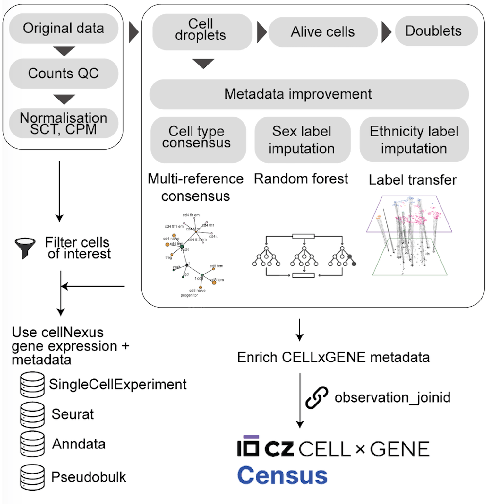
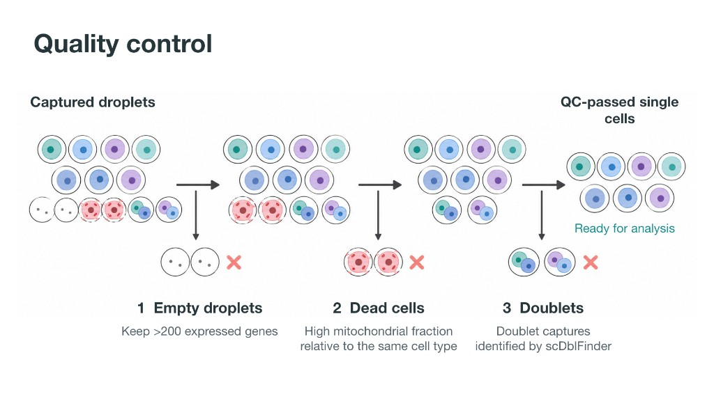
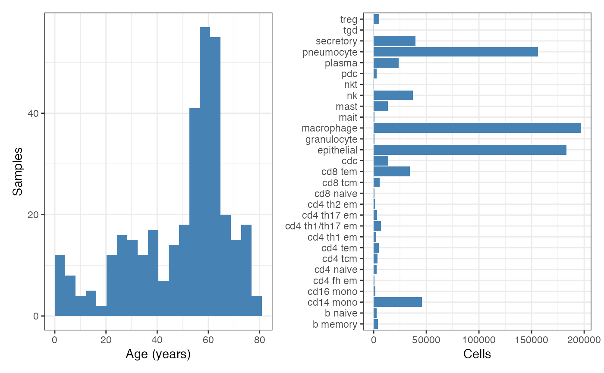

# 1. Query the atlas

This page is the script for the first block. Run the code in your R
session, in order. The figures on this site come from a larger example
run, so your own plots can differ when you use the smaller download used
in the session.

This article takes Human Cell Atlas data from CELLxGENE. Each study is a
table of measurements, with one row per cell. cellNexus makes that query
reusable and fast at the sample level. It also adds three cell-type
labels with SingleR, using the Blueprint, Monaco, and Azimuth
references. A harmonisation step then combines those three labels into
one unified cell-type label for every cell. The diagram below shows that
preprocessing, starting from the original CELLxGENE data.



## Setup

``` r

library(cellNexus)
library(dplyr)
library(ggplot2)
library(patchwork)
library(cellNexusWorkshop)
```

[`get_metadata()`](https://mangiolalaboratory.github.io/cellNexus/reference/get_metadata.html)
returns a lazy DuckDB table. Filters stay in the query until something
collects the rows, which is what makes an atlas of this size practical
to subset.

``` r

metadata <- get_metadata() |>
  keep_quality_cells()

metadata
```

    ## # A query:  ?? x 33
    ## # Database: DuckDB 1.5.5 [shen.m@Darwin 25.6.0:R 4.6.1/:memory:]
    ##    cell_id observation_joinid dataset_id        sample_id donor_id feature_count
    ##      <dbl> <chr>              <chr>             <chr>     <chr>            <int>
    ##  1    7951 V^DVv&wmix         ca46ffe6-0a26-4d~ 86fbf754~ Hs254            28675
    ##  2   10537 +P10$OJbtq         ca46ffe6-0a26-4d~ 86fbf754~ Hs254            28675
    ##  3    4681 `rtxaAa~)4         ca46ffe6-0a26-4d~ 86fbf754~ Hs254            28675
    ##  4   10538 YTZT;WA*H1         ca46ffe6-0a26-4d~ 86fbf754~ Hs254            28675
    ##  5   11685 q6&?h```1s         ca46ffe6-0a26-4d~ 86fbf754~ Hs254            28675
    ##  6   10539 {Ij`DT8SD?         ca46ffe6-0a26-4d~ 86fbf754~ Hs254            28675
    ##  7    4682 s1e`j)^y54         ca46ffe6-0a26-4d~ 86fbf754~ Hs254            28675
    ##  8    4683 0G5XsAaJ&m         ca46ffe6-0a26-4d~ 86fbf754~ Hs254            28675
    ##  9   10540 GPsK`oVmW=         ca46ffe6-0a26-4d~ 86fbf754~ Hs254            28675
    ## 10   10541 <iPo(ac}Y)         ca46ffe6-0a26-4d~ 86fbf754~ Hs254            28675
    ## # i more rows
    ## # i 27 more variables: age_days <int>, nFeature_expressed_in_sample <int>,
    ## #   nCount_RNA <dbl>, empty_droplet <lgl>, cell_type_unified_ensemble <chr>,
    ## #   is_immune <lgl>, subsets_Mito_percent <int>, subsets_Ribo_percent <int>,
    ## #   high_mitochondrion <lgl>, high_ribosome <lgl>, alive <lgl>,
    ## #   scDblFinder.class <chr>, file_id_cellNexus_single_cell <chr>,
    ## #   file_id_cellNexus_pseudobulk <chr>, count_upper_bound <dbl>, ...

[`keep_quality_cells()`](https://mangiolalaboratory.github.io/cellNexus/reference/keep_quality_cells.html)
applies one gate and filters out bad quality cells from every sample.



- An **empty droplet** is liquid captured with almost no cell in it. It
  still produces a few gene measurements, mostly background. Counting it
  as a cell inflates the number of cells and adds noise.
- A **dead cell** is detected by a high mitochondrial percentage.
- A **doublet** is two cells captured together. Their measurements are
  mixed, so the row can look like a cell type that does not exist.

The same checks are computed for each sample. Detailed information on
the procedure is the [cellNexus quality-control
steps](https://cellnexus.org/#quality-control-steps).

## Choose cells by cell type

`cell_type_unified_ensemble` is the harmonised label (multi-reference
consensus annotation). `age_days` and `imputed_ethnicity` are
sample-level fields that travel with every cell.

Exploring the harmonised cell types in the atlas.

``` r

metadata |>
  dplyr::distinct(cell_type_unified_ensemble) |>
  dplyr::arrange(cell_type_unified_ensemble)
```

    ## # A query:    ?? x 1
    ## # Database:   DuckDB 1.5.5 [shen.m@Darwin 25.6.0:R 4.6.1/:memory:]
    ## # Ordered by: cell_type_unified_ensemble
    ##    cell_type_unified_ensemble
    ##    <chr>                     
    ##  1 Unknown                   
    ##  2 b                         
    ##  3 b memory                  
    ##  4 b naive                   
    ##  5 blood                     
    ##  6 bone                      
    ##  7 cartilage                 
    ##  8 cd14 mono                 
    ##  9 cd16 mono                 
    ## 10 cd4 fh em                 
    ## # i more rows

Filtering the atlas by epithelial cells and exploring the imputed
ethnicities of the donors.

``` r

metadata |>
  dplyr::filter(cell_type_unified_ensemble == "epithelial") |>
  dplyr::distinct(donor_id, imputed_ethnicity) |>
  dplyr::count(imputed_ethnicity, sort = TRUE)
```

    ## # A query:    ?? x 2
    ## # Database:   DuckDB 1.5.5 [shen.m@Darwin 25.6.0:R 4.6.1/:memory:]
    ## # Ordered by: desc(n)
    ##    imputed_ethnicity              n
    ##    <chr>                      <dbl>
    ##  1 European                    1017
    ##  2 unknown                      804
    ##  3 African American              77
    ##  4 African                       76
    ##  5 East Asian                    49
    ##  6 Han Chinese                   39
    ##  7 South Asian                   27
    ##  8 Hispanic or Latin American    26
    ##  9 Hispanic/Latin American       15
    ## 10 British                       14
    ## # i more rows

> **Exercise 1.** Count cells per `cell_type_unified_ensemble` for
> donors older than 50 years (`age_days > 50 * 365`). Which labels are
> rare enough that a proportion estimated from 50 cells would be mostly
> sampling noise?

Solution

``` r

library(cellNexus)
library(dplyr)

get_metadata() |>
  keep_quality_cells() |>
  dplyr::filter(age_days > 50 * 365) |>
  dplyr::count(cell_type_unified_ensemble, sort = TRUE)
```

A label with a few dozen cells across the whole atlas will have a very
wide composition interval. Drop it from the cell-type list, or accept
that its estimate is descriptive.

## Choose cells by tissue

This case study uses nine respiratory reference studies.

``` r

respiratory_dataset_ids()
```

    ## [1] "9f222629-9e39-47d0-b83f-e08d610c7479"
    ## [2] "093d3bfe-6f0f-4ac0-a7a1-829f94d0a49f"
    ## [3] "8c42cfd0-0b0a-46d5-910c-fc833d83c45e"
    ## [4] "53d208b0-2cfd-4366-9866-c3c6114081bc"
    ## [5] "3de0ad6d-4378-4f62-b37b-ec0b75a50d94"
    ## [6] "d8da613f-e681-4c69-b463-e94f5e66847f"
    ## [7] "e04daea4-4412-45b5-989e-76a9be070a89"
    ## [8] "2adb1f8a-a6b1-4909-8ee8-484814e2d4bf"
    ## [9] "2672b679-8048-4f5e-9786-f1b196ccfd08"

``` r

dataset_ids <- respiratory_dataset_ids()

metadata |>
  dplyr::filter(dataset_id %in% dataset_ids) |>
  dplyr::distinct(dataset_id) |>
  dplyr::count()
```

    ## # A query:  ?? x 1
    ## # Database: DuckDB 1.5.5 [shen.m@Darwin 25.6.0:R 4.6.1/:memory:]
    ##       n
    ##   <dbl>
    ## 1     9

[`get_metadata()`](https://mangiolalaboratory.github.io/cellNexus/reference/get_metadata.html)
does not carry a tissue label.
[`join_census_tissue()`](https://myushen.github.io/cellNexusWorkshop/reference/join_census_tissue.md)
attaches the CELLxGENE Census `tissue` for each cell.
[`annotate_cell_nexus()`](https://myushen.github.io/cellNexusWorkshop/reference/annotate_cell_nexus.md)
then maps those labels onto `"respiratory system"` (lung, airway,
pleura, and the lobe names) and keeps that group. The nine `dataset_id`s
still pin which studies can enter. The tissue map drops a
non-respiratory cell if one of those studies contains one.

## Choose cells by disease

Disease lives on the same Census table.
[`join_census_tissue()`](https://myushen.github.io/cellNexusWorkshop/reference/join_census_tissue.md)
attaches it together with `tissue`. Count disease on the nine studies
before building the cohort. Joining the whole atlas is a large download,
so this call stays inside the study filter.

[`get_atlas_versions()`](https://mangiolalaboratory.github.io/cellNexus/reference/get_atlas_versions.html)
tells you which Census snapshot the atlas was built from.
[`join_census_tissue()`](https://myushen.github.io/cellNexusWorkshop/reference/join_census_tissue.md)
defaults to Census `2024-07-01`. Pass `census_version` when your
`atlas_id` was built from another snapshot.

``` r

get_atlas_versions()
```

    ## # A tibble: 7 x 6
    ##   atlas_id          census_version change_type description modified_at container
    ##   <chr>             <chr>          <chr>       <chr>       <chr>       <chr>    
    ## 1 cellxgene_2024/0~ 01-07-2024     initial     Initial re~ 2026-03-26  cellNexu~
    ## 2 hta_2025/0.1.0    21-10-2025     initial     Initial re~ 2026-03-26  cellNexu~
    ## 3 cellxgene_2024/0~ 01-07-2024     minor       Changed fi~ 2026-04-16  cellNexu~
    ## 4 cellxgene_2024/0~ 01-07-2024     bug         Fixed cell~ 2026-04-21  cellNexu~
    ## 5 cellxgene_2024/0~ 01-07-2024     minor       Updated tr~ 2026-05-26  cellNexu~
    ## 6 hca_2024/0.4.1    01-07-2024     minor       Updated th~ 2026-07-22  cellNexu~
    ## 7 hca_2024/0.5.0    01-07-2024     minor       Updated tr~ 2026-09-09  NA

``` r

dataset_ids <- respiratory_dataset_ids()

metadata |>
  dplyr::filter(dataset_id %in% dataset_ids) |>
  join_census_tissue() |>
  dplyr::count(disease, sort = TRUE)
```

    ## # A query:    ?? x 2
    ## # Database:   DuckDB 1.5.5 [shen.m@Darwin 25.6.0:R 4.6.1/:memory:]
    ## # Ordered by: desc(n)
    ##    disease                                     n
    ##    <chr>                                   <dbl>
    ##  1 normal                                2251070
    ##  2 COVID-19                               355118
    ##  3 pulmonary fibrosis                     246542
    ##  4 chronic obstructive pulmonary disease   62757
    ##  5 interstitial lung disease               60327
    ##  6 lung adenocarcinoma                     56717
    ##  7 pneumonia                               27890
    ##  8 chronic rhinitis                        26049
    ##  9 lung large cell carcinoma               19127
    ## 10 squamous cell lung carcinoma            18509
    ## 11 cystic fibrosis                         16194
    ## 12 lymphangioleiomyomatosis                11970
    ## 13 hypersensitivity pneumonitis             9774
    ## 14 pleomorphic carcinoma                    9213
    ## 15 non-specific interstitial pneumonia      8037
    ## 16 pulmonary sarcoidosis                    4611

## Build the respiratory ageing cohort

Composition uses the immune labels. Expression uses the epithelial
labels. Both sets are queried together and split later. Age is
restricted to donors from 1 year up to 80 years, which drops perinatal
samples and donors who would fall outside the age bins.

The donor is the replicate. Cells from one donor share genotype,
processing, and library preparation. A test that treats cells as
independent replicates reports a sample size equal to the number of
cells (Squair et al. 2021).

``` r

dataset_ids <- respiratory_dataset_ids()
cell_types_query <- c(immune_cell_types(), epithelial_cell_types())

obs_lung <- get_metadata() |>
  keep_quality_cells() |>
  dplyr::filter(
    dataset_id %in% dataset_ids,
    cell_type_unified_ensemble %in% cell_types_query,
    age_days >= 365,
    age_days < 80 * 365
  ) |>
  join_census_tissue() |>
  annotate_cell_nexus(min_cells_per_sample = 50)

obs_lung |>
  dplyr::count(cell_type_unified_ensemble, name = "n_cells") |>
  dplyr::arrange(dplyr::desc(n_cells))
```

    ## # A tibble: 29 x 2
    ##    cell_type_unified_ensemble n_cells
    ##    <chr>                        <int>
    ##  1 macrophage                  196975
    ##  2 epithelial                  183063
    ##  3 pneumocyte                  156299
    ##  4 cd14 mono                    45990
    ##  5 secretory                    39620
    ##  6 nk                           37230
    ##  7 cd8 tem                      34201
    ##  8 plasma                       23810
    ##  9 cdc                          13773
    ## 10 mast                         13578
    ## # i 19 more rows

[`join_census_tissue()`](https://myushen.github.io/cellNexusWorkshop/reference/join_census_tissue.md)
attaches Census `tissue`.
[`annotate_cell_nexus()`](https://myushen.github.io/cellNexusWorkshop/reference/annotate_cell_nexus.md)
keeps the respiratory labels, collects the query, derives the age
variables, drops samples with fewer than 50 cells, and de-duplicates on
`observation_joinid`. Every cell of every retained sample is kept.
`sccomp` conditions on each sample’s total, and the expression model
carries library size as a covariate, so equal-size subsampling would
throw away precision.

`age_binary` is `TRUE` for donors older than 50 years. `age_bin` is the
same split, labelled for plots. One encoding means the composition model
and the expression model contrast the same donors. The boundary is a
modelling choice: report it, and check that both sides are populated.

`dataset_id` values are rewritten with underscores. Hyphens in a UUID
become illegal coefficient names in limma. The filter above still uses
the hyphenated identifiers, because it runs before that rewrite.

## Inspect the cohort before modelling

Look at the age histogram and the cell-type bar chart before fitting a
model. Both age classes should contain donors. Ages clumped into two
distant groups will make a continuous age slope rest on whichever
studies sit at the extremes. A cell type with only a handful of cells
will have an uninformative composition interval.

``` r

p_age <- obs_lung |>
  dplyr::distinct(sample_id, age_years) |>
  ggplot(aes(age_years)) +
  geom_histogram(bins = 20, fill = "steelblue") +
  labs(x = "Age (years)", y = "Samples")

p_types <- obs_lung |>
  dplyr::count(cell_type_unified_ensemble, name = "n_cells") |>
  ggplot(aes(cell_type_unified_ensemble, n_cells)) +
  geom_col(fill = "steelblue") +
  coord_flip() +
  labs(x = NULL, y = "Cells")

p_age + p_types & theme_bw()
```




Example cohort. Left: one bar per sample age. Right: cells per
harmonised label.

> **Exercise 2.** How many distinct samples fall in each `age_bin`?

Solution

``` r

obs_lung |>
  dplyr::distinct(sample_id, age_bin) |>
  dplyr::count(age_bin)
```

Both bins should contain donors. A bin with a handful of samples cannot
support the age term once `dataset_id` is in the model.

> **Exercise 3.** Cross-tabulate distinct samples by `dataset_id` and
> `age_binary`. Which studies contain donors of both age classes? A
> study that contains only one class cannot separate age from study, and
> both models below include `dataset_id`.

Solution

``` r

obs_lung |>
  dplyr::distinct(sample_id, dataset_id, age_binary) |>
  dplyr::count(dataset_id, age_binary) |>
  tidyr::pivot_wider(names_from = age_binary, values_from = n, values_fill = 0)
```

A study with a zero in either age class does not identify an age effect
on its own. The fixed `dataset_id` term uses the studies that contain
both classes.

Keep this R session open. The next page uses `obs_lung`.

Next: [Explore and
visualise](https://myushen.github.io/cellNexusWorkshop/articles/explore_and_visualise.md).
