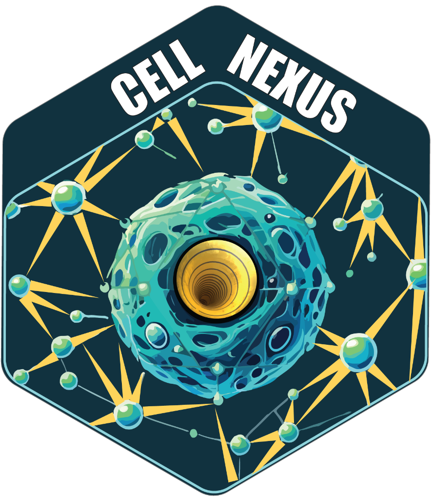

# cellNexusWorkshop



Hands-on ABACBS 2026 BiocAsia workshop. From a curated Human Cell Atlas
query to donor-level composition and expression analysis in R.

## Instructor names and contact information

- Mengyuan Shen [ shen.m@wehi.edu.au](mailto:shen.m@wehi.edu.au)
- Yingnan Gao [
  yingnan.gao@adelaide.edu.au](mailto:yingnan.gao@adelaide.edu.au)

## Syllabus

The workshop has four sections: query the atlas, explore and visualise
the cells, test cell-type composition, and test gene expression.

Follow these articles in one R session.

- [Query the
  atlas](https://myushen.github.io/cellNexusWorkshop/articles/query_the_atlas.md)
- [Explore and
  visualise](https://myushen.github.io/cellNexusWorkshop/articles/explore_and_visualise.md)
- [Compositional
  analysis](https://myushen.github.io/cellNexusWorkshop/articles/compositional_analysis.md)
- [Gene
  expression](https://myushen.github.io/cellNexusWorkshop/articles/gene_expression.md)
- [Solutions](https://myushen.github.io/cellNexusWorkshop/articles/solutions.md)

## Package installation

Each participant’s virtual machine already has these packages installed,
so you do not need to install them during the workshop. The commands
below are a reference for preparing a new machine. The workshop targets
R 4.6 or later. `cellNexus` is installed from GitHub. Install CmdStan
before the first `sccomp` fit so the session does not stop on a
compiler.

``` r
install.packages("BiocManager")
install.packages("remotes")

install.packages(
  "cmdstanr",
  repos = c("https://mc-stan.org/r-packages/", getOption("repos"))
)
cmdstanr::check_cmdstan_toolchain(fix = TRUE)
cmdstanr::install_cmdstan()

BiocManager::install(c(
  "dplyr", "tidyr", "ggplot2", "patchwork", "stringr", "Matrix",
  "SummarizedExperiment", "SingleCellExperiment",
  "scater", "scran", "scuttle", "scrapper", "bluster", "harmony",
  "DESeq2", "org.Hs.eg.db", "AnnotationDbi", "singscore",
  "tidySingleCellExperiment", "tidySummarizedExperiment",
  "tidybulk", "tidyseurat", "tidyomics", "Seurat",
  "dbplyr", "duckdb"
))

remotes::install_github("MangiolaLaboratory/cellNexus")
remotes::install_github("MangiolaLaboratory/sccomp")
remotes::install_github("myushen/cellNexusWorkshop")
```

The reusable script is
[`inst/scripts/workshop_respiratory_ageing.R`](https://github.com/myushen/cellNexusWorkshop/blob/main/inst/scripts/workshop_respiratory_ageing.R).

The analysis caches are already saved in the virtual environment, so the
session does not wait on the downloads or the model fits. Thanks to the
workshop organisers.

## Workshop description

In this session you will follow one respiratory ageing cohort from the
Human Cell Atlas through to two donor-level analyses. You will use
`cellNexus` to query and download the cohort, then explore and visualise
the cells with the `tidyomics` packages. You will use `sccomp` to test
immune cell-type composition, and then test gene expression in lung
epithelium. By the end of the session you will have an R script that
takes you from the atlas query to these analyses.

The cohort comes from nine Human Cell Atlas studies of the respiratory
system. The questions are whether immune cell-type proportions change
with age, and whether ageing changes transcription in lung epithelial
cells. After quality filtering and harmonising donor metadata, younger
and older donors are compared with `sccomp`, accounting for study.
Epithelial cells are then integrated with Harmony, clustered into six
populations, and aggregated to sample-level pseudobulk profiles. DESeq2
tests one epithelial cluster for age-associated genes, adjusting for
study and cell count. Those genes form an epithelial ageing signature,
which is scored on individual cells to show where the transcriptional
change sits across the epithelium.

### Pre-requisites

- Basic R experience is preferred but not required. The articles show
  each command.
- An R 4.6 session with the packages above, and CmdStan installed

### Workshop participation

The workshop is a 90-minute session of hands-on demos, exercises, and
questions. Each exercise has a solution hidden underneath it. The
[Solutions](https://myushen.github.io/cellNexusWorkshop/articles/solutions.md)
page collects the same answers.

The website shows the code. Run it in R to see your own results. The
full pipeline takes about 90 minutes, so the computationally heavy steps
were run ahead of time and are loaded during the workshop.

### *R* / *Bioconductor* packages used

- [cellNexus](https://github.com/MangiolaLaboratory/cellNexus)
- [sccomp](https://bioconductor.org/packages/sccomp)
- [tidySingleCellExperiment](https://bioconductor.org/packages/tidySingleCellExperiment)
- [tidySummarizedExperiment](https://bioconductor.org/packages/tidySummarizedExperiment)
- [tidybulk](https://bioconductor.org/packages/tidybulk)
- [tidyseurat](https://github.com/stemangiola/tidyseurat)
- [scater](https://bioconductor.org/packages/scater)
- [scran](https://bioconductor.org/packages/scran)
- [scrapper](https://bioconductor.org/packages/scrapper)
- [bluster](https://bioconductor.org/packages/bluster)
- [harmony](https://github.com/immunogenomics/harmony)
- [DESeq2](https://bioconductor.org/packages/DESeq2)
- [org.Hs.eg.db](https://bioconductor.org/packages/org.Hs.eg.db)
- [singscore](https://bioconductor.org/packages/singscore)

### Workshop goals and objectives

Participants leave with a script that defines a Human Cell Atlas cohort
from cellNexus metadata, downloads the matching counts, and fits two
donor-level models: cell-type composition, and gene expression within
one epithelial cluster.

#### Learning goals

- Query curated atlas metadata and turn a filter into a
  SingleCellExperiment or a Seurat object
- Keep the donor as the replicate for both composition and expression
- Detect composition changes with sccomp
- Test expression on sample-by-cluster pseudobulk with tidybulk

#### What you will learn

- How to filter cellNexus metadata by cell type, by a pinned set of
  studies, and by Census disease and tissue labels
- How tidySingleCellExperiment connects a SingleCellExperiment to dplyr
  and ggplot2
- A respiratory ageing case study: immune composition across nine
  studies, then epithelial differential expression

#### What you will not learn

- The molecular technology of single-cell sequencing
- How to train a cell-type classifier
- The Python interface

## References

- Shen et al. (2026). cellNexus: quality control, annotation,
  aggregation and analytical layers for the Human Cell Atlas data.
  *bioRxiv*.
  <https://www.biorxiv.org/content/10.64898/2026.04.14.718336v3>
- Mangiola et al. (2023). sccomp: robust differential composition and
  variability analysis for single-cell data. *Proceedings of the
  National Academy of Sciences*.
  <https://www.pnas.org/doi/10.1073/pnas.2203828120>
- Squair et al. (2021). Confronting false discoveries in single-cell
  differential expression. *Nature Communications* 12:5692.
  <https://doi.org/10.1038/s41467-021-25960-2>
- Lun, McCarthy, and Marioni (2016). A step-by-step workflow for
  low-level analysis of single-cell RNA-seq data with Bioconductor.
  *F1000Research* 5:2122.
  <https://doi.org/10.12688/f1000research.9501.2>
- Korsunsky et al. (2019). Fast, sensitive and accurate integration of
  single-cell data with Harmony. *Nature Methods* 16:1289–1296.
  <https://doi.org/10.1038/s41592-019-0619-0>
- Love, Huber, and Anders (2014). Moderated estimation of fold change
  and dispersion for RNA-seq data with DESeq2. *Genome Biology* 15:550.
  <https://doi.org/10.1186/s13059-014-0550-8>
- Foroutan et al. (2018). Single sample scoring of molecular phenotypes.
  *BMC Bioinformatics* 19:404.
  <https://doi.org/10.1186/s12859-018-2435-4>
- Gabry et al. (2019). Visualization in Bayesian workflow. *Journal of
  the Royal Statistical Society Series A* 182:389–402.
  <https://doi.org/10.1111/rssa.12378>

## Publish this site

Build the site locally with
[`pkgdown::build_site()`](https://pkgdown.r-lib.org/reference/build_site.html).
