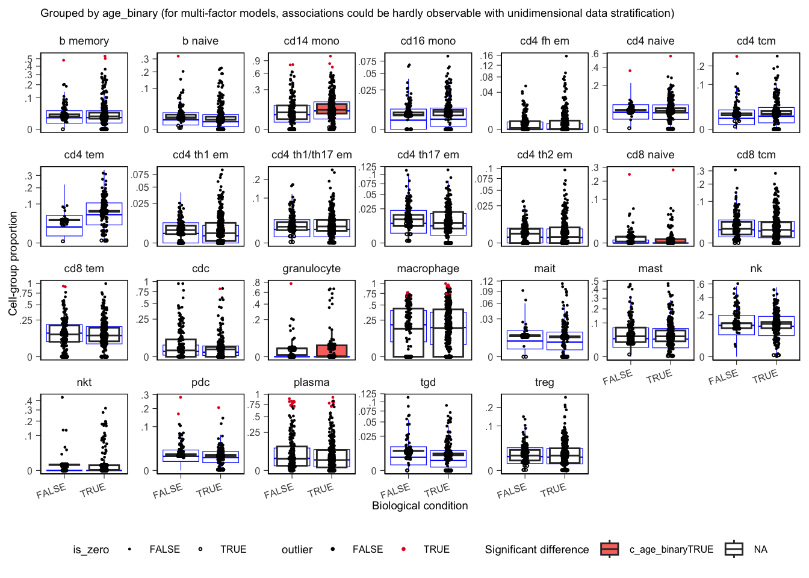

```{r setup, include=FALSE}
r_dir <- file.path(dirname(knitr::current_input(dir = TRUE)), "..", "R")
knitr::opts_chunk$set(
  echo = TRUE,
  eval = requireNamespace("pkgdown", quietly = TRUE) && pkgdown::in_pkgdown(),
  message = FALSE,
  warning = FALSE,
  cache = TRUE,
  cache.path = "compositional_analysis_cache/",
  cache.extra = tools::md5sum(file.path(
    r_dir,
    c("annotate_cell_nexus.R", "select_de_cluster.R", "cohort_definition.R")
  ))
)
library(dplyr)
library(cellNexus)
library(cellNexusWorkshop)
library(sccomp)
```

Continue in the same session. This block fits a donor-level model of immune cell-type proportions with `sccomp` [@mangiola2023sccomp].

```{r}
library(dplyr)
library(cellNexusWorkshop)
library(sccomp)

if (!exists("obs_lung")) {
  library(cellNexus)
  dataset_ids <- respiratory_dataset_ids()
  cell_types_query <- c(immune_cell_types(), epithelial_cell_types())
  obs_lung <- get_metadata() |>
    keep_quality_cells() |>
    dplyr::filter(
      dataset_id %in% dataset_ids,
      cell_type_unified_ensemble %in% cell_types_query,
      age_days >= 365,
      age_days < 80 * 365
    ) |>
    join_census_tissue() |>
    annotate_cell_nexus(min_cells_per_sample = 50)
}
```

## Why a composition model

This step quantifies age-associated shifts in **cell-type composition** on the immune subset of `obs_lung` (`obs_composition`): one donor-level simplex per sample over the immune types of the **same nine respiratory studies**. Epithelial types are excluded here because their capture is driven by dissociation protocol as much as by biology, and including them would move the denominator of every immune proportion. **Pseudobulk DE** and UMAP validation filter the full table to `epithelial` instead.

```{r}
obs_composition <- obs_lung |>
  dplyr::filter(cell_type_unified_ensemble %in% immune_cell_types()) |>
  # sccomp stores covariates in one column. A logical cannot share that
  # column with a character study id. "FALSE" is the reference level.
  dplyr::mutate(age_binary = as.character(age_binary))

obs_composition |>
  dplyr::count(cell_type_unified_ensemble, name = "n_cells") |>
  dplyr::arrange(dplyr::desc(n_cells))
```

## Fit

The formula is `~ age_binary + dataset_id`. `sample_id` is the replicate. `cell_type_unified_ensemble` is the group. `dataset_id` is a fixed effect, so the age contrast is within study.

`bimodal_mean_variability_association = TRUE` lets rare and abundant cell types follow different variability regimes.

The session default is `pathfinder`, which is fast enough to finish in the room. A result you would report uses Hamiltonian Monte Carlo (`inference_method = "hmc"`). Pathfinder intervals are a working approximation. Refit with `"hmc"` before you quote an effect, and read the sampler diagnostics on that fit. Set `CELLNEXUS_WORKSHOP_INFERENCE=hmc` for that fit. The first call compiles the Stan model and can take several minutes on top of the fit.

```{r echo=FALSE}
inference_method <- Sys.getenv("CELLNEXUS_WORKSHOP_INFERENCE", "pathfinder")

sccomp_res <- obs_composition |>
  sccomp_estimate(
    formula_composition = ~ age_binary + dataset_id,
    sample = "sample_id",
    cell_group = "cell_type_unified_ensemble",
    bimodal_mean_variability_association = TRUE,
    inference_method = inference_method
  ) |>
  sccomp_remove_outliers() |>
  sccomp_test()
```

Outlier removal refits the model with aberrant samples down-weighted. Removal comes before the test, because the test reads the refitted model. Look at which samples were flagged before accepting the correction. A flag concentrated in one study is a finding of its own.

```{r}
sccomp_res |>
  dplyr::filter(factor == "age_binary") |>
  dplyr::select(cell_type_unified_ensemble, dplyr::starts_with("c_"), c_FDR)
```

Columns whose names start with `c_` carry the age effect, its interval, `c_FDR`, and sampler diagnostics. On an HMC fit, `c_rhat` near 1 and a large effective sample size are the checks you want. The effect is on the model's composition scale.

An effect is a change in share. Because shares sum to one, one real change produces mirror-image changes in other labels. The label set is part of the result: this fit is a shift inside the immune compartment.

## Plot

`age_binary` has two levels, so the summary is a boxplot. `remove_unwanted_effects = TRUE` shows proportions after the study term has been regressed out, which is the visual counterpart of the model. The blue box is the posterior predictive check [@gabry2019visualization]: the distribution of data the model would produce. Overlap between the observed points and that distribution is evidence that the model describes these data.

```{r composition-plot}
sccomp_boxplot(
  sccomp_res,
  factor = "age_binary",
  significance_threshold = 0.05,
  remove_unwanted_effects = TRUE
)
```

```{r composition-figure, echo=FALSE, eval=TRUE, fig.cap="Example sccomp boxplots from a Hamiltonian Monte Carlo fit. Each point is one sample, after the study term has been removed."}

```

> **Exercise 6.** Which cell types have `c_FDR < 0.05` for `factor == "age_binary"`? For each, is the estimated effect higher or lower in donors over 50?

<details>
<summary>Solution</summary>

```r
sccomp_res |>
  dplyr::filter(factor == "age_binary", c_FDR < 0.05) |>
  dplyr::select(cell_type_unified_ensemble, dplyr::starts_with("c_"), c_FDR)
```

Read the sign of the effect column together with the boxplot. The contrast is donors over 50 against the reference level `"FALSE"` (50 and under), because `age_binary` was stored as character with `"FALSE"` first.

</details>

Next: [Gene expression](gene_expression.html).
