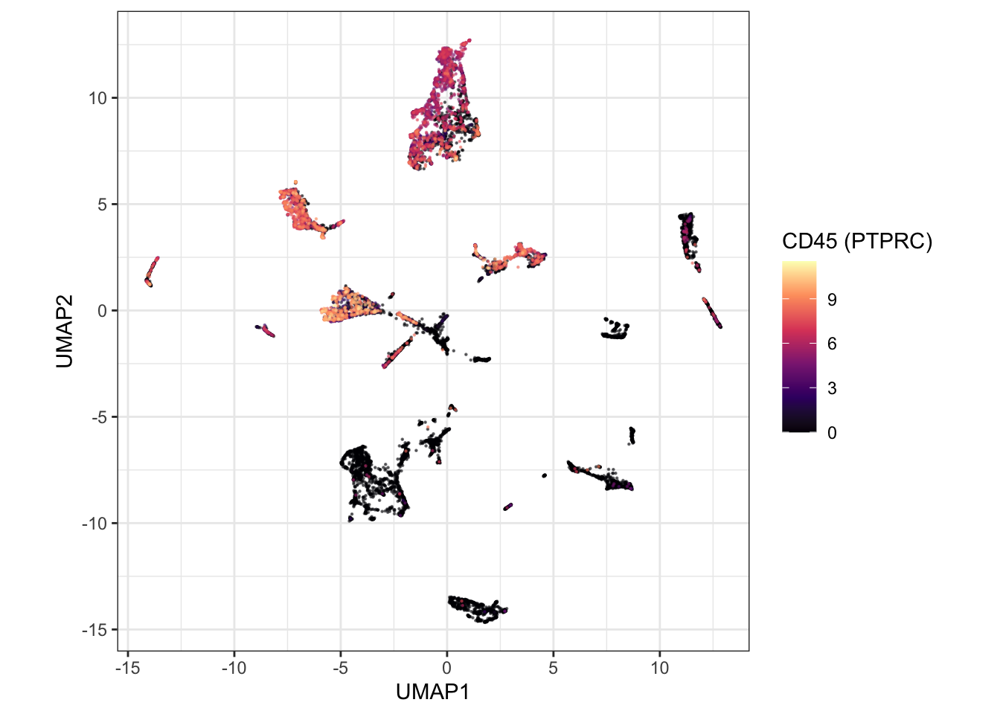

```{r setup, include=FALSE}
knitr::opts_chunk$set(echo = TRUE, eval = FALSE, message = FALSE, warning = FALSE)
```

Continue in the session from [Query the atlas](query_the_atlas.html). This block downloads a capped SingleCellExperiment, checks that immune and epithelial cells separate, and shows the same cells as a Seurat object.

```{r}
library(cellNexus)
library(cellNexusWorkshop)
library(dplyr)
library(ggplot2)
library(scater)
library(scran)
library(harmony)
library(SingleCellExperiment)
library(tidySingleCellExperiment)

if (!exists("obs_lung")) {
  obs_lung <- get_metadata() |>
    keep_quality_cells() |>
    dplyr::filter(
      dataset_id %in% respiratory_dataset_ids(),
      cell_type_unified_ensemble %in% c(immune_cell_types(), epithelial_cell_types()),
      age_days >= 365,
      age_days < 80 * 365
    ) |>
    annotate_cell_nexus(min_cells_per_sample = 50)
}
```

## Download a SingleCellExperiment

`get_single_cell_experiment()` reads the count matrices for the cells in a metadata table and returns one `SingleCellExperiment`. The workshop cap keeps the download inside a session. The example figures on this site use 12,000 cells. Set `CELLNEXUS_WORKSHOP_MAX_CELLS=12000` before this chunk to match them. Allow several minutes, and about 32 GB of RAM for the larger cap.

Cells are subsampled within sample, and the number of samples is capped, so a few large libraries do not dominate the highly variable genes.

```{r}
max_cells_qc <- as.integer(Sys.getenv("CELLNEXUS_WORKSHOP_MAX_CELLS", "4000"))
cells_per_sample_qc <- 80L
n_samples_qc <- max(1L, max_cells_qc %/% cells_per_sample_qc)

set.seed(42)
samples_qc <- dplyr::distinct(obs_lung, sample_id)
samples_qc <- dplyr::slice_sample(samples_qc, n = min(n_samples_qc, nrow(samples_qc)))

sampled_qc <- obs_lung |>
  dplyr::semi_join(samples_qc, by = "sample_id") |>
  dplyr::group_by(sample_id) |>
  dplyr::slice(sample.int(dplyr::n(), min(cells_per_sample_qc, dplyr::n()))) |>
  dplyr::ungroup()

sce_qc <- sampled_qc |>
  get_single_cell_experiment(assays = "counts") |>
  logNormCounts()

sce_qc
```

With `tidySingleCellExperiment` loaded, the object prints as a tibble and accepts `dplyr` verbs and `ggplot2`. The underlying assay is unchanged.

```{r}
sce_qc |>
  dplyr::count(cell_type_unified_ensemble, sort = TRUE)
```

## Integrate studies and colour by CD45

Highly variable genes are selected per sample (`modelGeneVar(block = sample_id)`), so genes that vary within a donor rank above genes that merely differ between libraries [@lun2016workflow]. Harmony then removes the study axis from the PCA [@korsunsky2019harmony]. The UMAP is drawn from that embedding.

CD45 (`PTPRC`, Ensembl `ENSG00000081237`) marks haematopoietic cells independently of the harmonised label. Immune cells should occupy the high-CD45 region.

```{r}
hvgs_qc <- sce_qc |>
  modelGeneVar(block = sce_qc$sample_id) |>
  getTopHVGs(n = 2000)

sce_qc <- sce_qc |>
  runPCA(ncomponents = 30, subset_row = hvgs_qc) |>
  RunHarmony(
    group.by.vars = "dataset_id",
    dims.use = 1:30,
    verbose = FALSE,
    reduction.save = "HARMONY"
  ) |>
  runUMAP(dimred = "HARMONY", n_neighbors = 15)

cd45_id <- c(
  grep("^ENSG00000081237(\\.|$)", rownames(sce_qc), value = TRUE),
  intersect("PTPRC", rownames(sce_qc))
)

if (length(cd45_id)) {
  sce_qc$cd45 <- as.numeric(logcounts(sce_qc)[cd45_id[[1]], ])
} else {
  sce_cd45 <- sampled_qc |>
    get_single_cell_experiment(assays = "counts", features = "ENSG00000081237")
  sce_qc$cd45 <- NA_real_
  i <- match(colnames(sce_qc), colnames(sce_cd45))
  sce_qc$cd45[!is.na(i)] <- log1p(
    as.numeric(SummarizedExperiment::assay(sce_cd45, "counts")[1, i[!is.na(i)]])
  )
  rm(sce_cd45)
}
```

```{r cd45-plot}
sce_qc |>
  ggplot(aes(UMAP1, UMAP2, colour = cd45)) +
  geom_point(size = 0.3, alpha = 0.6) +
  scale_colour_viridis_c(option = "magma") +
  coord_equal() +
  theme_bw() +
  labs(colour = "CD45 (PTPRC)")
```

```{r cd45-figure, echo=FALSE, eval=TRUE, fig.cap="Example Harmony UMAP, coloured by CD45. Immune cells occupy the high-CD45 region."}

```

The same grammar colours the embedding by the harmonised label.

```{r}
sce_qc |>
  ggplot(aes(UMAP1, UMAP2, colour = cell_type_unified_ensemble)) +
  geom_point(size = 0.3, alpha = 0.6) +
  coord_equal() +
  theme_bw() +
  labs(colour = "Cell type")
```

> **Exercise 4.** Colour the same UMAP by `dataset_id`. After Harmony, study identity should be mixed within a cell-type region. Islands that follow study boundaries are under-correction. Harmony adjusts the embedding used for the picture. It does not adjust the counts, so the models in the next two articles still include `dataset_id`.

<details>
<summary>Solution</summary>

```r
sce_qc |>
  ggplot2::ggplot(ggplot2::aes(UMAP1, UMAP2, colour = dataset_id)) +
  ggplot2::geom_point(size = 0.3, alpha = 0.6) +
  ggplot2::coord_equal() +
  ggplot2::theme_bw()
```

Mixing of colours inside a cell-type region is the pattern you want after Harmony. A region painted by a single study is under-correction. The expression model still includes `dataset_id`, because the counts were not adjusted.

</details>

> **Exercise 5.** Using `sce_qc`, count cells per `cell_type_unified_ensemble`. Which of `immune_cell_types()` are missing from this subsample, and what does that imply for a composition estimate built from these cells alone?

<details>
<summary>Solution</summary>

```r
library(cellNexusWorkshop)

sce_qc |>
  dplyr::count(cell_type_unified_ensemble, sort = TRUE)

setdiff(immune_cell_types(), unique(sce_qc$cell_type_unified_ensemble))
```

Labels missing from this subsample are absent because of the cap, not because they are absent from `obs_lung`. Composition in the next article is fit on `obs_lung`, which keeps every cell of every retained sample. Fitting `sccomp` on `sce_qc` would estimate the subsample.

</details>

## The same cells as a Seurat object

`get_seurat()` is `get_single_cell_experiment()` followed by the Seurat conversion. Pass a small metadata table. A handful of cells spread across many files downloads a handful of files.

```{r}
library(tidyseurat)

one_study <- obs_lung |>
  dplyr::filter(dataset_id == dplyr::first(dataset_id)) |>
  dplyr::slice_head(n = 100)

seurat_demo <- one_study |>
  get_seurat(assays = "counts")

seurat_demo
```

`tidyseurat` gives that object the same tibble interface you just used on the SingleCellExperiment. The rest of the workshop stays with SingleCellExperiment, because the pseudobulk tools speak that language.

```{r, include=FALSE}
rm(hvgs_qc, sampled_qc, samples_qc)
```

Next: [Compositional analysis](compositional_analysis.html).
