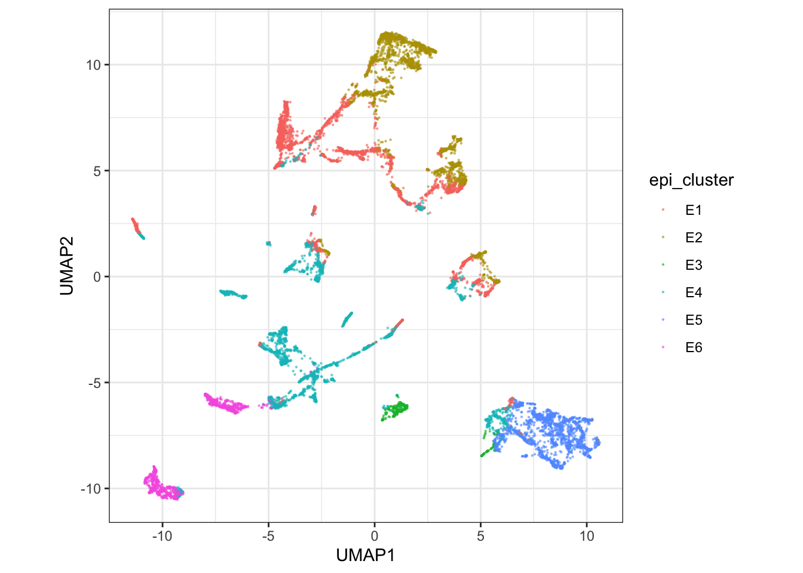
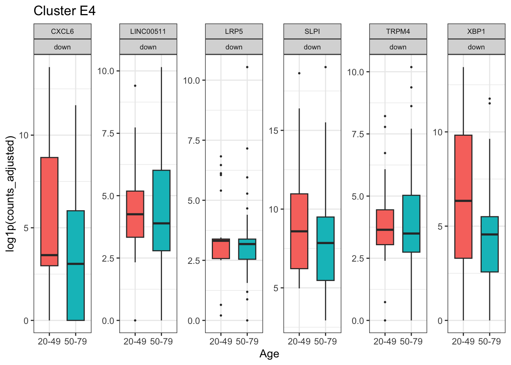

```{r setup, include=FALSE}
knitr::opts_chunk$set(echo = TRUE, eval = FALSE, message = FALSE, warning = FALSE)
```

Continue in the same session. This block integrates epithelial cells, aggregates sample-by-cluster pseudobulk, and tests donor-level age effects with DESeq2 through tidybulk [@love2014deseq2]. The last section scores the resulting signature back onto single cells [@foroutan2018singscore].

The reusable script for everything you have run is installed with the package:

```{r, eval=FALSE}
file.edit(system.file(
  "scripts", "workshop_respiratory_ageing.R",
  package = "cellNexusWorkshop"
))
```

```{r}
library(cellNexus)
library(cellNexusWorkshop)
library(dplyr)
library(ggplot2)
library(scater)
library(scuttle)
library(scran)
library(scrapper)
library(bluster)
library(harmony)
library(SingleCellExperiment)
library(SummarizedExperiment)
library(Matrix)
library(tidySingleCellExperiment)
library(tidySummarizedExperiment)
library(tidybulk)
library(AnnotationDbi)
library(org.Hs.eg.db)
library(stringr)

if (!exists("obs_lung")) {
  obs_lung <- get_metadata() |>
    keep_quality_cells() |>
    dplyr::filter(
      dataset_id %in% respiratory_dataset_ids(),
      cell_type_unified_ensemble %in% c(immune_cell_types(), epithelial_cell_types()),
      age_days >= 365,
      age_days < 80 * 365
    ) |>
    annotate_cell_nexus(min_cells_per_sample = 50)
}
```

## Integrate and cluster the epithelial compartment

The broad label `epithelial` mixes ciliated, secretory, basal, and alveolar states. We integrate cells, cut the embedding into six clusters, and test age inside the cluster that can support the design.

The download is capped by `CELLNEXUS_WORKSHOP_MAX_CELLS` (default 4000). The example figures use 12000 cells. Harmony here is for clustering and the UMAP. The counts still carry study effects, and the model below still includes `dataset_id`.

```{r}
epi_cell_cap <- as.integer(Sys.getenv("CELLNEXUS_WORKSHOP_MAX_CELLS", "4000"))
min_cells_pb <- 10L

set.seed(42)
epi_cells <- obs_lung |>
  dplyr::filter(cell_type_unified_ensemble == "epithelial")
epi_cells <- dplyr::slice_sample(
  epi_cells,
  n = min(epi_cell_cap, nrow(epi_cells))
)

sce_epi <- epi_cells |>
  get_single_cell_experiment(assays = "counts") |>
  logNormCounts()

hvgs <- sce_epi |>
  modelGeneVar() |>
  getTopHVGs(n = 2000)

sce_epi <- sce_epi |>
  runPCA(ncomponents = 30, subset_row = hvgs) |>
  RunHarmony(
    group.by.vars = "dataset_id",
    dims.use = 1:30,
    verbose = FALSE,
    reduction.save = "HARMONY"
  ) |>
  runUMAP(dimred = "HARMONY", n_neighbors = 15)

sce_epi$epi_cluster <- factor(paste0(
  "E",
  clusterCells(
    sce_epi,
    use.dimred = "HARMONY",
    BLUSPARAM = KmeansParam(centers = 6L)
  )
))
```

```{r epi-umap}
sce_epi |>
  ggplot(aes(UMAP1, UMAP2, colour = epi_cluster)) +
  geom_point(size = 0.3, alpha = 0.6) +
  coord_equal() +
  theme_bw()
```

```{r epi-figure, echo=FALSE, eval=TRUE, fig.cap="Example Harmony UMAP of epithelial cells, coloured by the six k-means clusters."}

```

k-means labels are arbitrary. `E1` in your session is not `E1` in the example figure. The next section chooses the cluster from a screen, which you report alongside the label.

## Aggregate sample-by-cluster pseudobulk

`aggregateAcrossCells.se()` sums raw counts within each sample and cluster. The column `ncells` is the number of cells that entered each pseudobulk. Profiles with fewer than 10 cells are dropped. `log_cell_count` is a scaled depth covariate so profiles built from different numbers of cells are comparable.

Precomputed `get_pseudobulk()` is sample by broad cell type. It is the right object for a cell-type-level question. This article needs sample by cluster, so the aggregation is done here.

```{r}
pb_se <- scrapper::aggregateAcrossCells.se(
  sce_epi,
  factors = list(
    sample_id = sce_epi$sample_id,
    epi_cluster = sce_epi$epi_cluster
  ),
  counts.name = "ncells"
)

SummarizedExperiment::assayNames(pb_se)[
  SummarizedExperiment::assayNames(pb_se) == "sums"
] <- "counts"

pb_se <- pb_se |>
  dplyr::filter(ncells >= min_cells_pb) |>
  dplyr::mutate(log_cell_count = as.numeric(scale(log1p(ncells))))

pb_se
```

Confirm that `ncells` is the size of the aggregation group. Row sums of the count matrix are library size, which is orders of magnitude larger, and using them as the depth covariate answers a different question.

## Choose a cluster and fit the age model

`select_de_cluster()` keeps clusters in which both age classes are represented and the design can separate age from study. It prefers the cluster supported by the most studies that contribute both age classes. The default screen asks for 150 cells and 5 samples in each class. A 4000-cell cap may need the slightly lower thresholds below. If the function stops, read the printed screen and lower `min_samples_per_class`, or raise `CELLNEXUS_WORKSHOP_MAX_CELLS` and rebuild `pb_se`.

```{r}
de_design <- ~ age_binary + log_cell_count + dataset_id
de_contrast <- list(c("age_binary", "old", "young"))
de_log2_fold_change_threshold <- 1
de_signature_max_genes <- 25L

epi_cluster_screen <- select_de_cluster(
  pb_se,
  de_design,
  min_cells_per_class = 100L,
  min_samples_per_class = 4L
)
epi_cluster_de_top <- epi_cluster_screen$cluster
epi_cluster_screen$screen
```

> **Exercise 8.** From `epi_cluster_screen$screen`, which cluster was chosen? How many studies in that cluster contribute both age classes (`n_datasets_spanning_age`)? Quote the screen table with the result. The label alone is not reproducible.

<details>
<summary>Solution</summary>

```r
epi_cluster_de_top
epi_cluster_screen$screen
```

The chosen row is the first row of the screen after eligible clusters are sorted by `n_datasets_spanning_age`, then by the number of pseudobulk profiles. Quote `n_datasets_spanning_age` for that row. A value of 1 means the age term rests on a single study.

</details>

The contrast is old versus young: positive log fold changes are higher in donors over 50. DESeq2 tests against a log2 fold change of 1, so the p-value asks whether the change exceeds a doubling. Say that when you report the p-values. `sfType = "poscounts"` estimates size factors on sparse pseudobulk, where the default median-of-ratios estimator can find no gene detected in every profile.

Genes are kept when they reach 5 counts per million in at least half of the profiles, evaluated with respect to age, so a gene expressed in one age class survives.

```{r}
pb_se <- pb_se[, pb_se$epi_cluster == epi_cluster_de_top]
pb_se <- pb_se[, Matrix::colSums(assay(pb_se, "counts")) > 0]

assay(pb_se, "counts") <- round(assay(pb_se, "counts"))
pb_se$sizeFactor <- NULL

pb_se$age_binary <- factor(
  ifelse(pb_se$age_binary, "old", "young"),
  levels = c("young", "old")
)

pb_se <- pb_se |>
  keep_abundant(
    formula_design = ~ age_binary,
    minimum_proportion = 0.5,
    minimum_count_per_million = 5
  ) |>
  test_differential_expression(
    de_design,
    contrasts = de_contrast,
    method = "DESeq2",
    omit_contrast_in_colnames = TRUE,
    test_above_log2_fold_change = de_log2_fold_change_threshold,
    sfType = "poscounts"
  ) |>
  adjust_abundance(
    .factor_unwanted = c(log_cell_count, dataset_id),
    .factor_of_interest = age_binary,
    method = "limma_remove_batch_effect"
  )
```

`adjust_abundance()` is for the figure. The test used the unadjusted counts. Batch-adjusted values stay out of any further test.

```{r}
de_results <- rowData(pb_se) |>
  tibble::as_tibble(rownames = ".feature") |>
  dplyr::mutate(
    gene_symbol = AnnotationDbi::mapIds(
      org.Hs.eg.db,
      keys = stringr::str_replace(.feature, "\\.[0-9]+$", ""),
      keytype = "ENSEMBL",
      column = "SYMBOL",
      multiVals = "first"
    ) |>
      unname() |>
      dplyr::coalesce(.feature)
  )

signature_up <- de_results |>
  dplyr::filter(pvalue < 0.05, log2FoldChange > 0) |>
  dplyr::slice_min(pvalue, n = de_signature_max_genes)

signature_down <- de_results |>
  dplyr::filter(pvalue < 0.05, log2FoldChange < 0) |>
  dplyr::slice_min(pvalue, n = de_signature_max_genes)

signature_up
```

The signature uses a nominal p-value cutoff, capped at 25 genes in each direction. It is a gene set for scoring. A claim about an individual gene needs the false-discovery column as well. Report both.

```{r}
marker_genes <- dplyr::bind_rows(
  dplyr::mutate(signature_up, direction = "up"),
  dplyr::mutate(signature_down, direction = "down")
) |>
  dplyr::select(.feature, gene_symbol, direction)

marker_plot_df <- pb_se[marker_genes$.feature, ] |>
  as_tibble() |>
  dplyr::left_join(marker_genes, by = ".feature")
```

```{r marker-plot}
ggplot(marker_plot_df, aes(age_bin, log1p(counts_adjusted), fill = age_bin)) +
  geom_boxplot(outlier.size = 0.4, width = 0.65) +
  facet_wrap(~ gene_symbol + direction, scales = "free_y", ncol = 6) +
  theme_bw() +
  theme(legend.position = "none", strip.text = element_text(size = 7)) +
  labs(
    x = "Age",
    y = "log1p(counts_adjusted)",
    title = paste("Cluster", epi_cluster_de_top)
  )
```

```{r marker-figure, echo=FALSE, eval=TRUE, fig.cap="Example marker boxplots. Each point is a donor-level pseudobulk profile in the cluster the screen selected. Abundance is log1p of the batch-adjusted count."}

```

> **Exercise 9.** In `de_contrast`, which age class is the numerator? Check one gene in `signature_up` against its boxplot and confirm the direction matches.

<details>
<summary>Solution</summary>

`c("age_binary", "old", "young")` tests old against young. Positive `log2FoldChange` means higher abundance in donors over 50. The boxplot for a gene in `signature_up` should sit higher in the `50-79` bin. If it sits lower, the factor levels and the contrast disagree.

</details>

## Score the signature on single cells

If time remains. The score is the mean rank of the up genes minus the mean rank of the down genes, on the cells of the cluster that was tested. A shift between age classes is expected, because the genes were chosen on these donors. Treat it as a consistency check: a reversed or empty shift means a reversed contrast, the wrong cluster, or an identifier mismatch. Report how many signature genes were found in the matrix. Ensembl identifiers with a version suffix are a common way to lose most of the set. Generalisation needs donors held out before gene selection, or another cohort.

```{r}
library(singscore)

sce <- sce_epi |>
  dplyr::filter(epi_cluster == epi_cluster_de_top)

rank_mat <- rankGenes(as.matrix(assay(sce, "logcounts")))
sce$aging_signature_score <- simpleScore(
  rank_mat,
  upSet = signature_up$.feature,
  downSet = if (nrow(signature_down) > 0) signature_down$.feature else NULL
)$TotalScore

mean(signature_up$.feature %in% rownames(sce))
mean(signature_down$.feature %in% rownames(sce))
```

```{r}
sce |>
  ggplot(aes(UMAP1, UMAP2, colour = aging_signature_score)) +
  geom_point(size = 0.3, alpha = 0.6) +
  scale_colour_viridis_c(option = "magma") +
  facet_wrap(~ age_bin, ncol = 2) +
  coord_equal() +
  theme_bw() +
  labs(colour = "Ageing score", title = paste("Cluster", epi_cluster_de_top))
```

```{r}
sce |>
  ggplot(aes(aging_signature_score, fill = age_bin, colour = age_bin)) +
  geom_density(alpha = 0.35, linewidth = 0.6) +
  theme_bw() +
  labs(x = "Ageing signature score", y = "Density", fill = "Age", colour = "Age")
```

## What you now have

One session, from a cellNexus query to two donor-level answers:

- whether immune proportions differ between donors under and over 50, at fixed study (`sccomp_res`)
- whether epithelial transcription in one cluster differs between those same donors (`de_results`)

Save the script from `system.file("scripts", "workshop_respiratory_ageing.R", package = "cellNexusWorkshop")`. Changing the dataset list, the cell-type vectors, or the age cut is how the same workflow moves to another tissue or another question.

Solutions: [Solutions](solutions.html).
