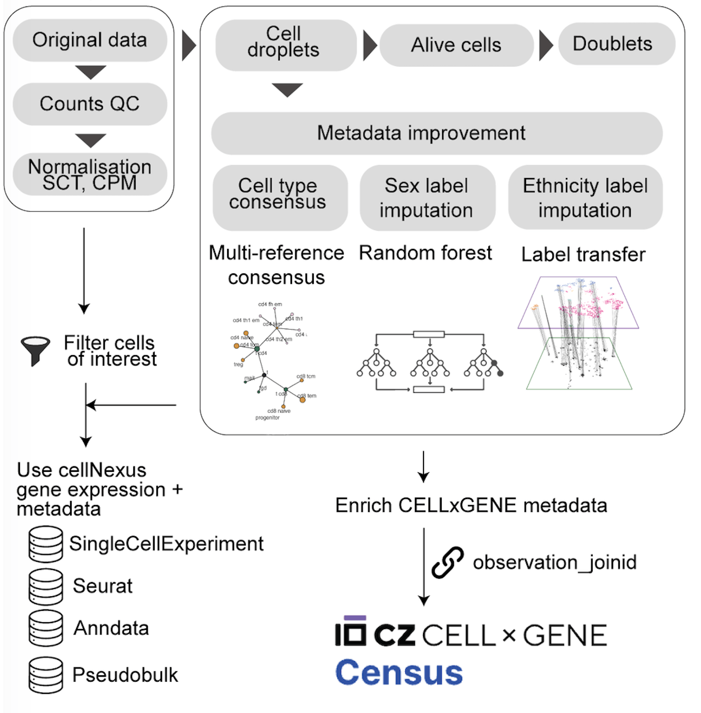

```{r setup, include=FALSE}
knitr::opts_chunk$set(
  echo = TRUE,
  eval = requireNamespace("pkgdown", quietly = TRUE) && pkgdown::in_pkgdown(),
  message = FALSE,
  warning = FALSE,
  cache = TRUE,
  cache.path = "query_the_atlas_cache/"
)
library(cellNexus)
library(dplyr)
library(ggplot2)
library(patchwork)
```

Source:
[`vignettes/query_the_atlas.Rmd`](https://github.com/myushen/cellNexusWorkshop/blob/HEAD/vignettes/query_the_atlas.Rmd)


This practice takes Human Cell Atlas data from CELLxGENE. Each study is a table of measurements at single cell level (one row per cell). cellNexus makes that query reusable and fast at the sample level. It also adds three cell-type labels with SingleR, using the Blueprint, Monaco, and Azimuth references. A harmonisation step then combines those three labels into one unified cell-type label for every cell. The diagram below shows the preprocessing steps, starting from the original CELLxGENE data.

```{r abstract-figure, echo=FALSE, eval=TRUE, out.width="420", fig.align="left"}

```

## Setup

```{r}
library(cellNexus)
library(dplyr)
library(ggplot2)
library(patchwork)
```

`get_metadata()` returns a lazy DuckDB table, and accepts `tidyverse` syntax to filter the data.


## Quality control
```{r quality-control-figure, echo=FALSE, eval=TRUE, out.width="100%", fig.align="left"}
knitr::include_graphics("../man/figures/quality-control.png")
```

* An **empty droplet** is liquid captured with almost no cell in it. It still produces a few gene measurements, mostly background. Counting it as a cell inflates the number of cells and adds noise.
* A **dead cell** is detected by a high mitochondrial percentage.
* A **doublet** is two cells captured together. Their measurements are mixed, so the row can look like a cell type that does not exist.

```{r}
metadata <- get_metadata() |>
  keep_quality_cells()

metadata
```

`keep_quality_cells()` applies one gate and filters out bad quality cells from every sample. This is a filter shortcut, which is equivalent to directly applying three filters to each sample: `empty_droplet == FALSE, alive == TRUE, scDblFinder.class != "doublet"`.

The same checks are computed for each sample. Detailed technical information on the quality-control procedure is available in the [cellNexus quality-control steps](https://cellnexus.org/#quality-control-steps) page.


## Choose cells by cell type

`cell_type_unified_ensemble` is the harmonised label (multi-reference consensus annotation). `age_days` and `imputed_ethnicity` are sample-level fields.

Exploring the harmonised cell types in the atlas.

```{r}
metadata |>
  dplyr::distinct(cell_type_unified_ensemble) |>
  dplyr::arrange(cell_type_unified_ensemble)
```

Filtering the atlas by epithelial cells and exploring the imputed ethnicities of the donors.

```{r}
metadata |>
  dplyr::filter(cell_type_unified_ensemble == "epithelial") |>
  dplyr::distinct(donor_id, imputed_ethnicity) |>
  dplyr::count(imputed_ethnicity, sort = TRUE)
```

> **Exercise 1.** Count cells per `cell_type_unified_ensemble` for donors older than 50 years (`age_days > 50 * 365`). Which labels are rare enough that a proportion estimated from 50 cells would be mostly sampling noise?

<details>
<summary>Solution</summary>

```r
library(cellNexus)
library(dplyr)

get_metadata() |>
  keep_quality_cells() |>
  dplyr::filter(age_days > 50 * 365) |>
  dplyr::count(cell_type_unified_ensemble, sort = TRUE)
```

A label with a few dozen cells across the whole atlas will have a very wide composition interval. Drop it from the cell-type list, or accept that its estimate is descriptive.

</details>


This case study uses nine respiratory reference studies. Each study has a unique `dataset_id`.

```{r}
dataset_ids <- c(
  "9f222629-9e39-47d0-b83f-e08d610c7479",
  "093d3bfe-6f0f-4ac0-a7a1-829f94d0a49f",
  "8c42cfd0-0b0a-46d5-910c-fc833d83c45e",
  "53d208b0-2cfd-4366-9866-c3c6114081bc",
  "3de0ad6d-4378-4f62-b37b-ec0b75a50d94",
  "d8da613f-e681-4c69-b463-e94f5e66847f",
  "e04daea4-4412-45b5-989e-76a9be070a89",
  "2adb1f8a-a6b1-4909-8ee8-484814e2d4bf",
  "2672b679-8048-4f5e-9786-f1b196ccfd08"
)
```

## Query metadata by tissue {.tabset}

`get_metadata()` does not carry original CELLxGENE annotations such as `tissue`, `disease`, `sex`, `assay`, `cell_type`, and `self_reported_ethnicity`. Join those columns onto `get_metadata()`.

The file below is the CELLxGENE Census `obs` table for snapshot `2024-07-01`, limited to these nine studies and to the columns this join uses. `cellxgene.census` does not run on Windows, so the workshop reads this parquet instead of opening the Census.

### Register the Arrow table

`duckdb_register_arrow()` makes the Arrow table visible to the same DuckDB connection as `metadata`, so the join stays lazy.

```{r, eval=FALSE}
census_metadata <- cellNexus::get_census_metadata("2024-07-01")
con <- dbplyr::remote_con(metadata)
duckdb::duckdb_register_arrow(con, "census_metadata", census_metadata)

metadata_respiratory <- metadata |>
  dplyr::filter(dataset_id %in% dataset_ids) |>
  dplyr::left_join(
    dplyr::tbl(con, "census_metadata") |>
      dplyr::select(
        observation_joinid, dataset_id, tissue,
        self_reported_ethnicity, cell_type, assay,
        disease, sex
      ),
    by = c("observation_joinid", "dataset_id")
  )

metadata_respiratory |>
  dplyr::count(tissue, sort = TRUE)
```

### This workshop - Read and join without registering

Since `cellxgene.census` does not run on Windows, the workshop reads this parquet instead of opening the Census. Read the parquet as a data frame and join back to the metadata.

```{r}
census_metadata <- arrow::read_parquet(
  system.file(
    "extdata",
    "census_respiratory_2024-07-01.parquet",
    package = "cellNexusWorkshop"
  )
)

metadata_respiratory <- metadata |>
  dplyr::filter(dataset_id %in% dataset_ids) |>
  dplyr::left_join(
    census_metadata |>
      dplyr::select(
        observation_joinid, dataset_id, tissue,
        self_reported_ethnicity, cell_type, assay,
        disease, sex
      ),
    by = c("observation_joinid", "dataset_id"),
    copy = TRUE
  )

metadata_respiratory |>
  dplyr::count(tissue, sort = TRUE)
```


## Query metadata by disease

```{r}
metadata_respiratory |>
  dplyr::count(disease, sort = TRUE)
```

## Build the respiratory ageing cohort

This step keeps immune and epithelial labels, lung and airway tissues, and donors from 1 year up to 80 years.

`dplyr::collect()` runs the query. `dataset_id` is rewritten with underscores because a hyphenated UUID is not a legal name in a model formula. `age_years`, `age_binary`, and `age_bin` are derived here so the composition model and the expression model use the same donors. Samples with fewer than 50 cells are dropped, and duplicate `observation_joinid` rows are removed. Every cell of every retained sample is kept. `sccomp` conditions on each sample's total, and the expression model carries library size as a covariate, so equal-size subsampling would throw away precision.

```{r}
respiratory_tissues <- c(
  "lung", "lung parenchyma", "alveolus of lung", "bronchus",
  "respiratory airway", "pleura", "pleural effusion",
  "middle lobe of right lung", "upper lobe of left lung",
  "lower lobe of left lung", "upper lobe of right lung",
  "lower lobe of right lung", "lingula of left lung",
  "right lung", "left lung"
)

immune_cell_types <- c(
  "cd16 mono", "nk", "mait", "cd14 mono", "cdc", "b memory", "pdc",
  "nkt", "cd4 th1/th17 em", "plasma", "cd4 th17 em", "b naive", "macrophage",
  "cd4 th2 em", "cd8 tcm", "cd8 naive", "cd8 tem", "tgd", "cd4 fh em",
  "cd4 th1 em", "cd4 tem", "cd4 naive", "mast", "treg", "cd4 tcm", "granulocyte"
)
epithelial_cell_types <- c("epithelial", "pneumocyte", "secretory")
cell_types_query <- c(immune_cell_types, epithelial_cell_types)

obs_lung <- metadata_respiratory |>
  dplyr::filter(
    cell_type_unified_ensemble %in% c(immune_cell_types, epithelial_cell_types),
    tissue %in% respiratory_tissues,
    age_days >= 365,
    age_days < 80 * 365
  ) |>
  dplyr::collect() |>
  dplyr::mutate(
    sample_id = as.character(sample_id),
    dataset_id = gsub("-", "_", as.character(dataset_id), fixed = TRUE),
    age_years = as.numeric(age_days / 365.25),
    age_binary = age_years > 50,
    age_bin = cut(
      age_years,
      breaks = c(0, 50, 80),
      right = FALSE,
      labels = c("20-49", "50-79")
    )
  )

# Drop samples below 50 cells 
obs_lung <- obs_lung |>
  dplyr::filter(dplyr::n() >= 50, .by = sample_id) |>
  dplyr::arrange(dataset_id, sample_id, observation_joinid) |>
  dplyr::distinct(observation_joinid, .keep_all = TRUE)

age_scaled <- obs_lung |>
  dplyr::distinct(sample_id, age_years) |>
  dplyr::mutate(
    age_years_scaled_centered = as.numeric(scale(age_years)[, 1])
  ) |>
  dplyr::select(sample_id, age_years_scaled_centered)

obs_lung <- obs_lung |>
  dplyr::left_join(age_scaled, by = "sample_id")

obs_lung |>
  dplyr::count(cell_type_unified_ensemble, name = "n_cells") |>
  dplyr::arrange(dplyr::desc(n_cells))
```

```{r, include=FALSE, eval=FALSE}
extdata_dir <- file.path(
  dirname(knitr::current_input(dir = TRUE)),
  "..", "inst", "extdata"
)
dir.create(extdata_dir, recursive = TRUE, showWarnings = FALSE)
saveRDS(obs_lung, file.path(extdata_dir, "obs_lung.rds"), compress = "xz")
```

`age_binary` is `TRUE` for donors older than 50 years. `age_bin` is the same split, labelled for plots. One encoding means the composition model and the expression model contrast the same donors. The boundary is a modelling choice: report it, and check that both sides are populated.

## Inspect the cohort before modelling

Look at the age histogram and the cell-type bar chart before fitting a model. Both age classes should contain donors. Ages clumped into two distant groups will make a continuous age slope rest on whichever studies sit at the extremes. A cell type with only a handful of cells will have an uninformative composition interval.

```{r, include=FALSE, eval=TRUE}
obs_lung <- readRDS(
  system.file("extdata", "obs_lung.rds", package = "cellNexusWorkshop")
)
```

```{r manifest-plot}
p_age <- obs_lung |>
  dplyr::distinct(sample_id, age_years) |>
  ggplot(aes(age_years)) +
  geom_histogram(bins = 20, fill = "steelblue") +
  labs(x = "Age (years)", y = "Samples")

p_types <- obs_lung |>
  dplyr::count(cell_type_unified_ensemble, name = "n_cells") |>
  ggplot(aes(cell_type_unified_ensemble, n_cells)) +
  geom_col(fill = "steelblue") +
  coord_flip() +
  labs(x = NULL, y = "Cells")

p_age + p_types & theme_bw()
```


> **Exercise 2.** How many distinct samples fall in each `age_bin`?

<details>
<summary>Solution</summary>

```r
obs_lung |>
  dplyr::distinct(sample_id, age_bin) |>
  dplyr::count(age_bin)
```

Both bins should contain donors. A bin with a handful of samples cannot support the age term once `dataset_id` is in the model.

</details>

> **Exercise 3.** Cross-tabulate distinct samples by `dataset_id` and `age_binary`. Which studies contain donors of both age classes? A study that contains only one class cannot separate age from study, and both models below include `dataset_id`.

<details>
<summary>Solution</summary>

```r
obs_lung |>
  dplyr::distinct(sample_id, dataset_id, age_binary) |>
  dplyr::count(dataset_id, age_binary) |>
  tidyr::pivot_wider(names_from = age_binary, values_from = n, values_fill = 0)
```

A study with a zero in either age class does not identify an age effect on its own. The fixed `dataset_id` term uses the studies that contain both classes.

</details>

Next: [Explore and visualise](explore_and_visualise.html).
