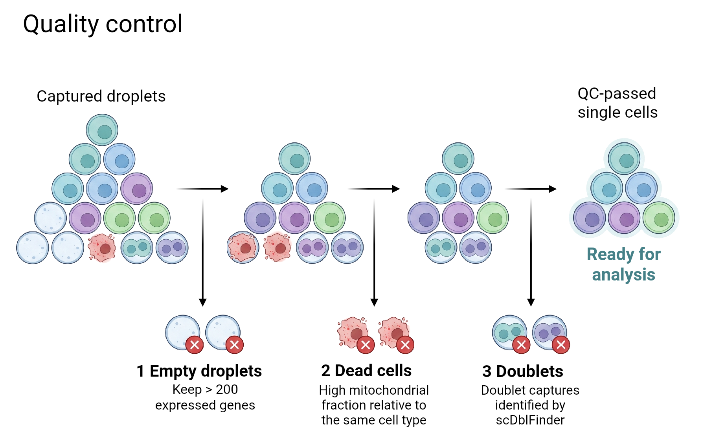

```{r setup, include=FALSE}
knitr::opts_chunk$set(
  echo = TRUE,
  eval = requireNamespace("pkgdown", quietly = TRUE) && pkgdown::in_pkgdown(),
  message = FALSE,
  warning = FALSE,
  cache = TRUE,
  cache.path = "query_the_atlas_cache/"
)
library(cellNexus)
library(dplyr)
library(ggplot2)
library(patchwork)
```

## Human Cell Atlas data in cellNexus

The Human Cell Atlas (HCA) aims to create a comprehensive cellular map of the human body. Early work by the Human Cell Atlas consortium produced reference maps of healthy tissues, including the lung, the eye, and the nervous system. The consortium plans to extend that draft atlas to more biological networks.

CELLxGENE, from the Chan Zuckerberg Initiative, makes these data easier to use through interactive visualisation and analysis. Its Census API gives programmatic access to a large collection of harmonised single-cell datasets, which simplifies extraction and large-scale analysis.

Those datasets still have no shared framework for quality control, for putting RNA abundance on one scale, for imputing missing annotations, or for harmonising cell-type labels. cellNexus downloads single-cell data at scale, and adds those quality-control and harmonisation layers on top of the CELLxGENE data.

This practice takes Human Cell Atlas data from CELLxGENE. Each study is a table of measurements at single cell level (one row per cell). cellNexus makes that query reusable and fast at the sample level. It also adds three cell-type labels with SingleR, using the Blueprint, Monaco, and Azimuth references. A harmonisation step then combines those three labels into one unified cell-type label for every cell. The diagram below shows the preprocessing steps, starting from the original CELLxGENE data.

```{r abstract-figure, echo=FALSE, eval=TRUE, out.width="420", fig.align="left"}
knitr::include_graphics("../man/figures/abstract.png")
```

This article assembles the cohort for both workshop questions. It keeps immune and epithelial cells from nine respiratory studies, with donor age and Census tissue and disease labels.

## Load the packages

The query uses `cellNexus` for the atlas metadata, and `dplyr`, `ggplot2`, and `patchwork` to filter and plot the cohort.

```{r}
library(cellNexus)
library(dplyr)
library(ggplot2)
library(patchwork)
```

## Read metadata and qualit control

Quality control is computed within each sample. A cell has to pass all three checks before it enters the cohort.

```{r quality-control-figure, echo=FALSE, eval=TRUE, out.width="100%", fig.align="left"}

```

* An **empty droplet** is liquid captured with almost no cell in it. It still produces a few gene measurements, mostly background. Counting it as a cell inflates the number of cells and adds noise.
* A **dead cell** is detected by a high mitochondrial percentage.
* A **doublet** is two cells captured together. Their measurements are mixed, so the row can look like a cell type that does not exist.

```{r, cache=FALSE}
metadata <- get_metadata() |>
  dplyr::filter(empty_droplet == FALSE, alive == TRUE, scDblFinder.class != "doublet")

metadata
```

`get_metadata()` returns a lazy DuckDB table, and accepts `tidyverse` syntax to filter the data.

Alternatively, `cellNexus::keep_quality_cells()` provides a shortcut to filter high quality cells, which is equivalent to directly applying three filters to each sample: `empty_droplet == FALSE, alive == TRUE, scDblFinder.class != "doublet"`.

The same checks are computed for each sample. Detailed technical information on the quality-control procedure is available in the [cellNexus quality-control steps](https://cellnexus.org/#quality-control-steps) page.


## List the harmonised cell types

`cell_type_unified_ensemble` is one label per cell. It combines SingleR annotations from the Blueprint, Monaco, and Azimuth references. The table below is every label in the atlas after quality control.


```{r, cache=FALSE}
metadata |>
  dplyr::distinct(cell_type_unified_ensemble) |>
  dplyr::arrange(cell_type_unified_ensemble)
```


## Count donors by imputed ethnicity

More than 40% of donors in CELLxGENE have no recorded ethnicity. `cellNexus` supplies an imputed ethnicity for each donor. The imputation method is outside this workshop due to time limit. The table counts donors who have epithelial cells.

```{r, cache=FALSE}
metadata |>
  dplyr::filter(cell_type_unified_ensemble == "epithelial") |>
  dplyr::distinct(donor_id, imputed_ethnicity) |>
  dplyr::count(imputed_ethnicity, sort = TRUE)
```

## Select nine respiratory studies

These nine Human Cell Atlas dataset identifiers define the respiratory cohort. Tissue, disease, and the other Census columns are joined onto this list in the next section.

```{r}
dataset_ids <- c(
  "9f222629-9e39-47d0-b83f-e08d610c7479",
  "093d3bfe-6f0f-4ac0-a7a1-829f94d0a49f",
  "8c42cfd0-0b0a-46d5-910c-fc833d83c45e",
  "53d208b0-2cfd-4366-9866-c3c6114081bc",
  "3de0ad6d-4378-4f62-b37b-ec0b75a50d94",
  "d8da613f-e681-4c69-b463-e94f5e66847f",
  "e04daea4-4412-45b5-989e-76a9be070a89",
  "2adb1f8a-a6b1-4909-8ee8-484814e2d4bf",
  "2672b679-8048-4f5e-9786-f1b196ccfd08"
)
```

## Join annotations from the Census {.tabset}

`get_metadata()` does not carry the original CELLxGENE columns `tissue`, `disease`, `sex`, `assay`, `cell_type`, and `self_reported_ethnicity`. Both tabs join those columns from the Census `obs` table for snapshot `2024-07-01`, limited to these nine studies.

### Register the Census table in DuckDB

`duckdb_register_arrow()` makes the Arrow table visible to the same DuckDB connection as `metadata`, so the join stays lazy. This path needs the Census package.

```{r, eval=FALSE}
census_metadata <- cellNexus::get_census_metadata("2024-07-01")
con <- dbplyr::remote_con(metadata)
duckdb::duckdb_register_arrow(con, "census_metadata", census_metadata)

metadata_respiratory <- metadata |>
  dplyr::filter(dataset_id %in% dataset_ids) |>
  dplyr::left_join(
    dplyr::tbl(con, "census_metadata") |>
      dplyr::select(
        observation_joinid, dataset_id, tissue,
        self_reported_ethnicity, cell_type, assay,
        disease, sex
      ),
    by = c("observation_joinid", "dataset_id")
  )

metadata_respiratory |>
  dplyr::count(tissue, sort = TRUE)
```

### Read the workshop parquet

`cellxgene.census` does not run on Windows, so this workshop reads the same columns from a parquet file and joins them with `copy = TRUE`.

```{r, cache=FALSE}
census_metadata <- arrow::read_parquet(
  system.file(
    "extdata",
    "census_respiratory_2024-07-01.parquet",
    package = "cellNexusWorkshop"
  )
)

metadata_respiratory <- metadata |>
  dplyr::filter(dataset_id %in% dataset_ids) |>
  dplyr::left_join(
    census_metadata |>
      dplyr::select(
        observation_joinid, dataset_id, tissue,
        self_reported_ethnicity, cell_type, assay,
        disease, sex
      ),
    by = c("observation_joinid", "dataset_id"),
    copy = TRUE
  )

metadata_respiratory |>
  dplyr::count(tissue, sort = TRUE)
```


## Count cells by disease

Disease labels come from the Census join. Count the number of cells by disease.

```{r, cache=FALSE}
metadata_respiratory |>
  dplyr::count(disease, sort = TRUE)
```

> **Exercise 1.** What is the age span of donors with European imputed ethnicity who contributed healthy tissue? Report the youngest and oldest donor in years. Count each donor once.

<details>
<summary>Solution</summary>

```r
metadata_respiratory |>
  dplyr::filter(
    imputed_ethnicity == "European",
    disease == "normal"
  ) |>
  dplyr::distinct(donor_id, age_days) |>
  dplyr::summarise(
    n_donors = dplyr::n(),
    min_age_years = min(age_days) / 365.25,
    max_age_years = max(age_days) / 365.25
  )
```

`disease == "normal"` is the healthy label in the Census. `distinct(donor_id)` keeps one row per donor, so a donor with many cells does not pull the span. The span is `max_age_years - min_age_years`.

</details>

## Build the respiratory ageing cohort

This step keeps immune and epithelial labels, lung and airway tissues, and donors from 1 year up to 80 years. `age_years`, `age_binary`, and `age_bin` are derived here so the composition model and the expression model use the same donors. Samples with fewer than 50 cells are dropped.

```{r, cache=FALSE}
respiratory_tissues <- c(
  "lung", "lung parenchyma", "alveolus of lung", "bronchus",
  "respiratory airway", "pleura", "pleural effusion",
  "middle lobe of right lung", "upper lobe of left lung",
  "lower lobe of left lung", "upper lobe of right lung",
  "lower lobe of right lung", "lingula of left lung",
  "right lung", "left lung"
)

immune_cell_types <- c(
  "cd16 mono", "nk", "mait", "cd14 mono", "cdc", "b memory", "pdc",
  "nkt", "cd4 th1/th17 em", "plasma", "cd4 th17 em", "b naive", "macrophage",
  "cd4 th2 em", "cd8 tcm", "cd8 naive", "cd8 tem", "tgd", "cd4 fh em",
  "cd4 th1 em", "cd4 tem", "cd4 naive", "mast", "treg", "cd4 tcm", "granulocyte"
)
epithelial_cell_types <- c("epithelial", "pneumocyte", "secretory")
cell_types_query <- c(immune_cell_types, epithelial_cell_types)

obs_lung <- metadata_respiratory |>
  dplyr::filter(
    cell_type_unified_ensemble %in% c(immune_cell_types, epithelial_cell_types),
    tissue %in% respiratory_tissues,
    age_days >= 365,
    age_days < 80 * 365
  ) |>
  dplyr::collect() |>
  dplyr::mutate(
    sample_id = as.character(sample_id),
    dataset_id = gsub("-", "_", as.character(dataset_id), fixed = TRUE),
    age_years = as.numeric(age_days / 365.25),
    age_binary = age_years > 50,
    age_bin = cut(
      age_years,
      breaks = c(0, 50, 80),
      right = FALSE,
      labels = c("20-49", "50-79")
    )
  )

# Drop samples below 50 cells 
obs_lung <- obs_lung |>
  dplyr::filter(dplyr::n() >= 50, .by = sample_id) |>
  dplyr::arrange(dataset_id, sample_id, observation_joinid) |>
  dplyr::distinct(observation_joinid, .keep_all = TRUE)

obs_lung |>
  dplyr::count(cell_type_unified_ensemble, name = "n_cells") |>
  dplyr::arrange(dplyr::desc(n_cells))
```

```{r, include=FALSE, eval=FALSE}
extdata_dir <- file.path(
  dirname(knitr::current_input(dir = TRUE)),
  "..", "inst", "extdata"
)
dir.create(extdata_dir, recursive = TRUE, showWarnings = FALSE)
saveRDS(obs_lung, file.path(extdata_dir, "obs_lung.rds"), compress = "xz")
```

`age_binary` is `TRUE` for donors older than 50 years. `age_bin` is the same split, labelled for plots.

## Inspect age and cell type before modelling

The histogram is donor age, counted once per sample. The bar chart is cells per harmonised label. Both age classes should contain samples. Ages clumped into two distant groups will make a continuous age slope rest on whichever studies sit at the extremes. A cell type with only a handful of cells will have an uninformative composition interval.

```{r, include=FALSE, eval=TRUE}
obs_lung <- readRDS(
  system.file("extdata", "obs_lung.rds", package = "cellNexusWorkshop")
)
```

```{r manifest-plot}
p_age <- obs_lung |>
  dplyr::distinct(sample_id, age_years) |>
  ggplot(aes(age_years)) +
  geom_histogram(bins = 20, fill = "steelblue") +
  labs(x = "Age (years)", y = "Samples")

p_types <- obs_lung |>
  dplyr::count(cell_type_unified_ensemble, name = "n_cells") |>
  ggplot(aes(cell_type_unified_ensemble, n_cells)) +
  geom_col(fill = "steelblue") +
  coord_flip() +
  labs(x = NULL, y = "Cells")

p_age + p_types & theme_bw()
```


> **Exercise 2.** How many distinct samples fall in each `age_bin`?

<details>
<summary>Solution</summary>

```r
obs_lung |>
  dplyr::distinct(sample_id, age_bin) |>
  dplyr::count(age_bin)
```

Both bins should contain donors. A bin with a handful of samples cannot support the age term once `dataset_id` is in the model.

</details>

> **Exercise 3.** Cross-tabulate distinct samples by `dataset_id` and `age_binary`. Which studies contain samples of both age classes?

<details>
<summary>Solution</summary>

```r
age_by_study <- obs_lung |>
  dplyr::distinct(sample_id, dataset_id, age_binary) |>
  dplyr::mutate(age_class = ifelse(age_binary, "older", "younger")) |>
  dplyr::count(dataset_id, age_class) |>
  tidyr::pivot_wider(names_from = age_class, values_from = n, values_fill = 0)

age_by_study

age_by_study |>
  dplyr::filter(younger > 0, older > 0)
```

</details>

Next: [Explore and visualise](explore_and_visualise.html).
