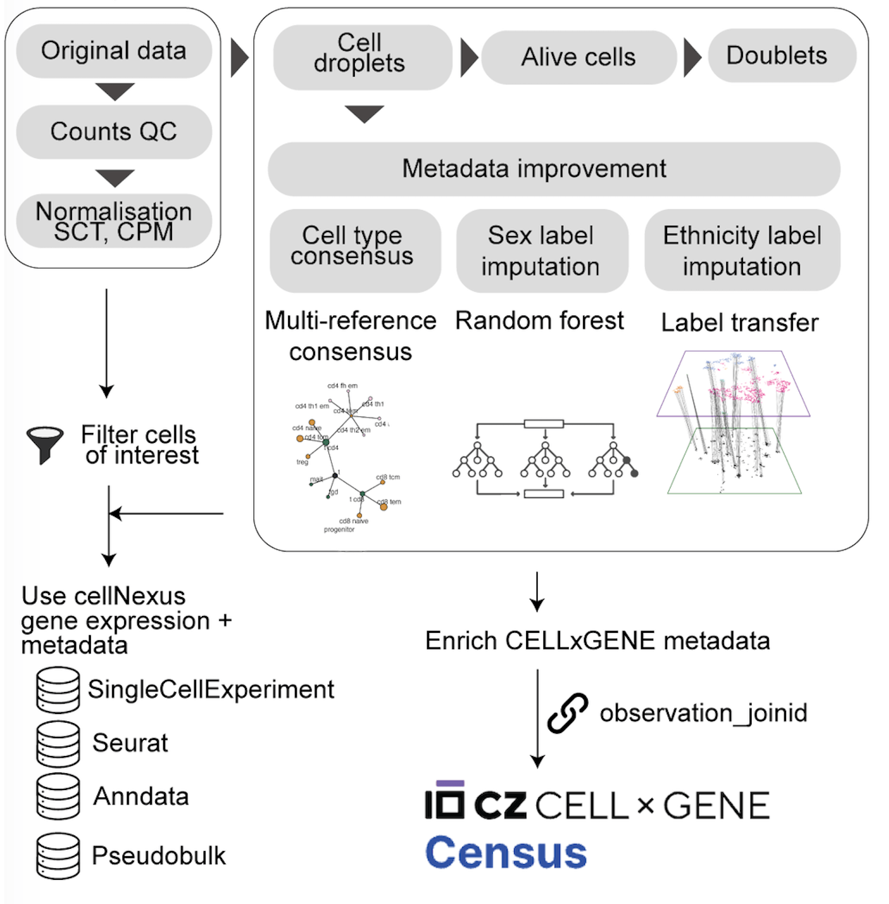
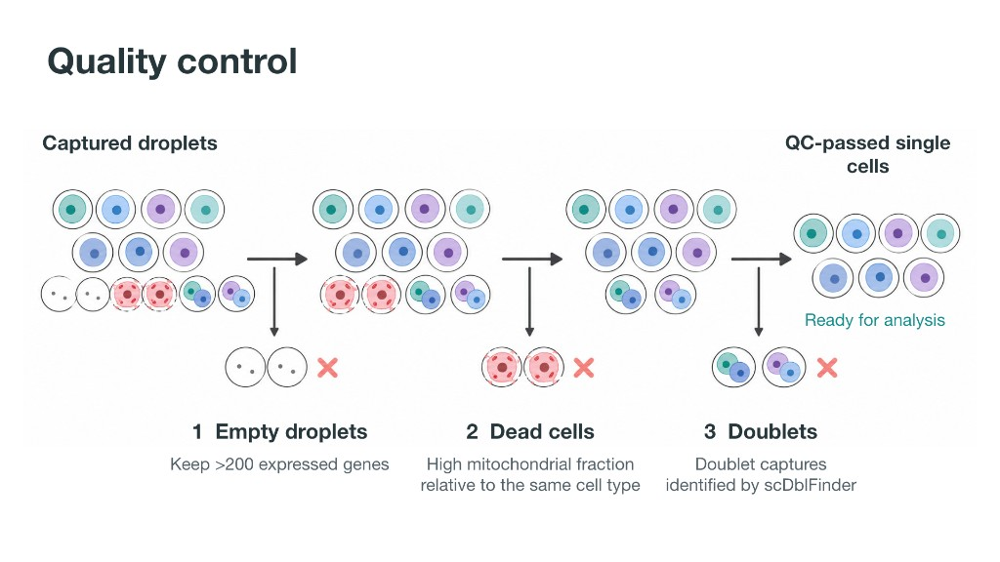

```{r setup, include=FALSE}
r_dir <- file.path(dirname(knitr::current_input(dir = TRUE)), "..", "R")
knitr::opts_chunk$set(
  echo = TRUE,
  eval = requireNamespace("pkgdown", quietly = TRUE) && pkgdown::in_pkgdown(),
  message = FALSE,
  warning = FALSE,
  cache = TRUE,
  cache.path = "query_the_atlas_cache/",
  cache.extra = tools::md5sum(file.path(
    r_dir,
    c("annotate_cell_nexus.R", "select_de_cluster.R", "cohort_definition.R")
  ))
)
library(cellNexus)
library(dplyr)
library(ggplot2)
library(patchwork)
library(cellNexusWorkshop)
```

This page is the script for the first block. Run the code in your R session, in order.

This practice takes Human Cell Atlas data from CELLxGENE. Each study is a table of measurements at single cell level (one row per cell). cellNexus makes that query reusable and fast at the sample level. It also adds three cell-type labels with SingleR, using the Blueprint, Monaco, and Azimuth references. A harmonisation step then combines those three labels into one unified cell-type label for every cell. The diagram below shows the preprocessing steps, starting from the original CELLxGENE data.

```{r abstract-figure, echo=FALSE, eval=TRUE, out.width="420", fig.align="left"}

```

## Setup

```{r}
library(cellNexus)
library(dplyr)
library(ggplot2)
library(patchwork)
library(cellNexusWorkshop)
```

`get_metadata()` returns a lazy DuckDB table. Filters stay in the query until something collects the rows, which is what makes an atlas of this size practical to subset.


```{r}
metadata <- get_metadata() |>
  keep_quality_cells()

metadata
```

`keep_quality_cells()` applies one gate and filters out bad quality cells from every sample.

```{r quality-control-figure, echo=FALSE, eval=TRUE, out.width="100%", fig.align="left"}

```

* An **empty droplet** is liquid captured with almost no cell in it. It still produces a few gene measurements, mostly background. Counting it as a cell inflates the number of cells and adds noise.
* A **dead cell** is detected by a high mitochondrial percentage.
* A **doublet** is two cells captured together. Their measurements are mixed, so the row can look like a cell type that does not exist.


The same checks are computed for each sample. Detailed information on the procedure is the [cellNexus quality-control steps](https://cellnexus.org/#quality-control-steps).

## Choose cells by cell type

`cell_type_unified_ensemble` is the harmonised label (multi-reference consensus annotation). `age_days` and `imputed_ethnicity` are sample-level fields.

Exploring the harmonised cell types in the atlas.

```{r}
metadata |>
  dplyr::distinct(cell_type_unified_ensemble) |>
  dplyr::arrange(cell_type_unified_ensemble)
```

Filtering the atlas by epithelial cells and exploring the imputed ethnicities of the donors.

```{r}
metadata |>
  dplyr::filter(cell_type_unified_ensemble == "epithelial") |>
  dplyr::distinct(donor_id, imputed_ethnicity) |>
  dplyr::count(imputed_ethnicity, sort = TRUE)
```

> **Exercise 1.** Count cells per `cell_type_unified_ensemble` for donors older than 50 years (`age_days > 50 * 365`). Which labels are rare enough that a proportion estimated from 50 cells would be mostly sampling noise?

<details>
<summary>Solution</summary>

```r
library(cellNexus)
library(dplyr)

get_metadata() |>
  keep_quality_cells() |>
  dplyr::filter(age_days > 50 * 365) |>
  dplyr::count(cell_type_unified_ensemble, sort = TRUE)
```

A label with a few dozen cells across the whole atlas will have a very wide composition interval. Drop it from the cell-type list, or accept that its estimate is descriptive.

</details>


This case study uses nine respiratory reference studies in particular. `join_census_tissue()` appends CELLxGENE Census demographic annotations such as `tissue`, `disease`, `sex`, `age_days`, etc to the metadata.

```{r}
respiratory_dataset_ids()
```

## Query metadata by tissue

```{r}
dataset_ids <- respiratory_dataset_ids()
metadata_respiratory <- metadata |>
  dplyr::filter(dataset_id %in% dataset_ids) |>
  join_census_tissue()

metadata_respiratory |>
  dplyr::count(tissue, sort = TRUE)
```

## Query metadata by disease

```{r}
metadata_respiratory |>
  dplyr::count(disease, sort = TRUE)
```

## Build the respiratory ageing cohort

Immune and epithelial cell types are queried. Age is restricted to donors from 1 year up to 80 years, which drops perinatal samples and donors who would fall outside the age bins.

```{r}
cell_types_query <- c(immune_cell_types(), epithelial_cell_types())

obs_lung <- get_metadata() |>
  keep_quality_cells() |>
  dplyr::filter(
    dataset_id %in% dataset_ids,
    cell_type_unified_ensemble %in% cell_types_query,
    age_days >= 365,
    age_days < 80 * 365
  ) |>
  join_census_tissue() |>
  annotate_cell_nexus(min_cells_per_sample = 50)

obs_lung |>
  dplyr::count(cell_type_unified_ensemble, name = "n_cells") |>
  dplyr::arrange(dplyr::desc(n_cells))
```

`join_census_tissue()` attaches Census `tissue`. `annotate_cell_nexus()` keeps the respiratory labels, collects the query, derives the age variables, drops samples with fewer than 50 cells, and de-duplicates on `observation_joinid`. Every cell of every retained sample is kept. `sccomp` conditions on each sample's total, and the expression model carries library size as a covariate, so equal-size subsampling would throw away precision.

`age_binary` is `TRUE` for donors older than 50 years. `age_bin` is the same split, labelled for plots. One encoding means the composition model and the expression model contrast the same donors. The boundary is a modelling choice: report it, and check that both sides are populated.

## Inspect the cohort before modelling

Look at the age histogram and the cell-type bar chart before fitting a model. Both age classes should contain donors. Ages clumped into two distant groups will make a continuous age slope rest on whichever studies sit at the extremes. A cell type with only a handful of cells will have an uninformative composition interval.

```{r manifest-plot}
p_age <- obs_lung |>
  dplyr::distinct(sample_id, age_years) |>
  ggplot(aes(age_years)) +
  geom_histogram(bins = 20, fill = "steelblue") +
  labs(x = "Age (years)", y = "Samples")

p_types <- obs_lung |>
  dplyr::count(cell_type_unified_ensemble, name = "n_cells") |>
  ggplot(aes(cell_type_unified_ensemble, n_cells)) +
  geom_col(fill = "steelblue") +
  coord_flip() +
  labs(x = NULL, y = "Cells")

p_age + p_types & theme_bw()
```


> **Exercise 2.** How many distinct samples fall in each `age_bin`?

<details>
<summary>Solution</summary>

```r
obs_lung |>
  dplyr::distinct(sample_id, age_bin) |>
  dplyr::count(age_bin)
```

Both bins should contain donors. A bin with a handful of samples cannot support the age term once `dataset_id` is in the model.

</details>

> **Exercise 3.** Cross-tabulate distinct samples by `dataset_id` and `age_binary`. Which studies contain donors of both age classes? A study that contains only one class cannot separate age from study, and both models below include `dataset_id`.

<details>
<summary>Solution</summary>

```r
obs_lung |>
  dplyr::distinct(sample_id, dataset_id, age_binary) |>
  dplyr::count(dataset_id, age_binary) |>
  tidyr::pivot_wider(names_from = age_binary, values_from = n, values_fill = 0)
```

A study with a zero in either age class does not identify an age effect on its own. The fixed `dataset_id` term uses the studies that contain both classes.

</details>

Keep this R session open. The next page uses `obs_lung`.

Next: [Explore and visualise](explore_and_visualise.html).
