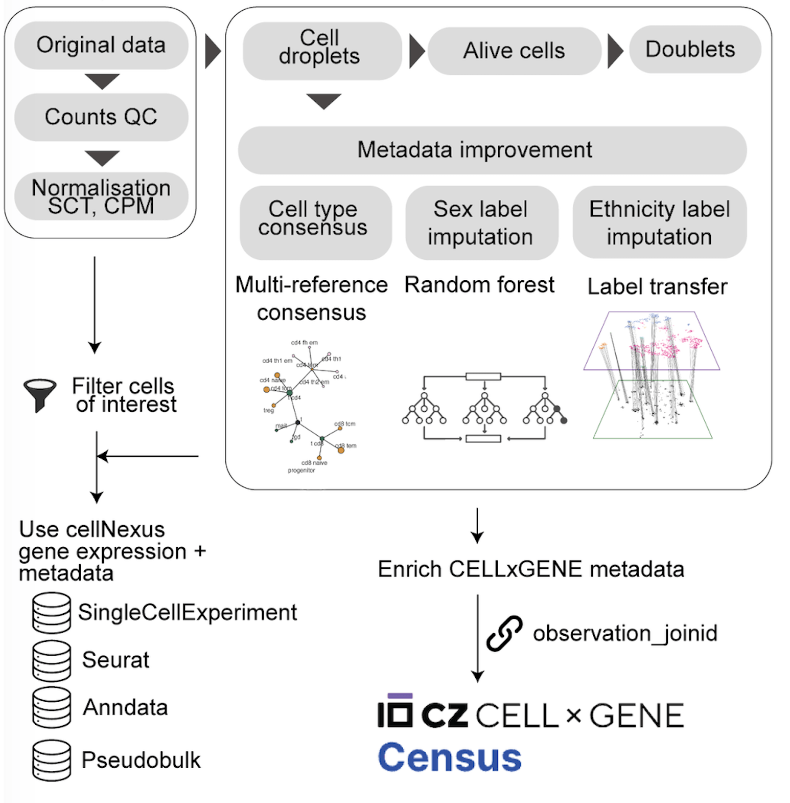
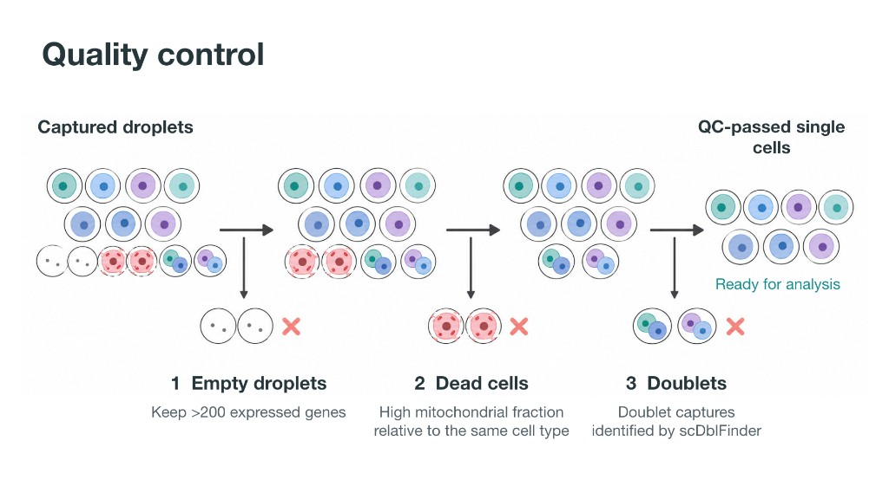
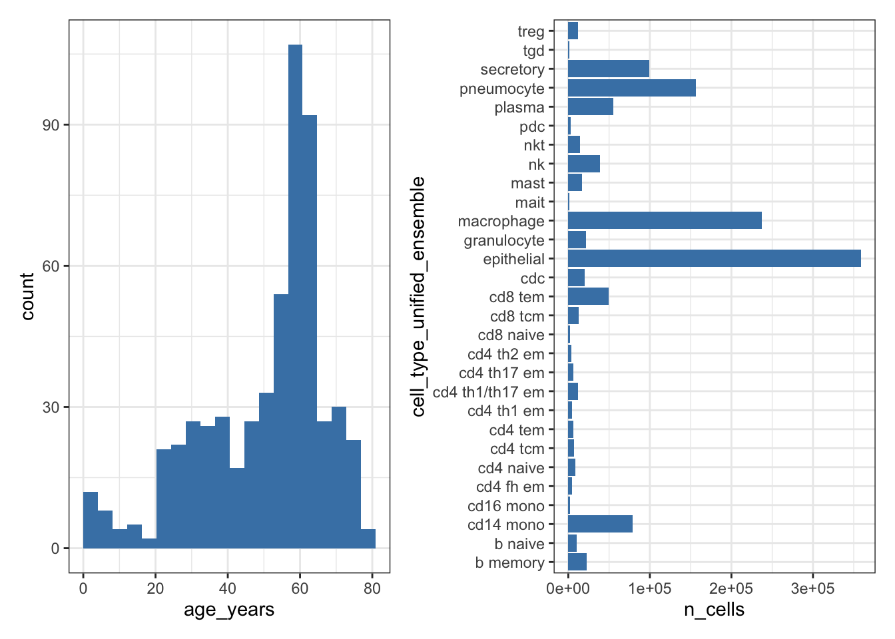

```{r setup, include=FALSE}
knitr::opts_chunk$set(echo = TRUE, eval = FALSE, message = FALSE, warning = FALSE)
```

This page is the script for the first block. Run the code in your R session, in order. The figures on this site come from a larger example run, so your own plots can differ when you use the smaller download used in the session.

This article takes Human Cell Atlas data from CELLxGENE. Each study there is a table of measurements, with one row per cell. cellNexus has already spent a large amount of work making those studies usable together. It creates a sample id for each donor with a set of rules, because the original studies do not share one identifier for a person. It prepares each sample and checks data quality. It adds three cell-type labels with SingleR, using the Blueprint, Monaco, and Azimuth references. A harmonisation step then combines those three labels into one unified cell-type label for every cell. The diagram is the detail of that preprocessing, starting from the original CELLxGENE data.

```{r abstract-figure, echo=FALSE, eval=TRUE, out.width="420", fig.align="left"}

```

## Setup

```{r}
library(cellNexus)
library(dplyr)
library(ggplot2)
library(patchwork)
library(cellNexusWorkshop)
```

`get_metadata()` returns a lazy DuckDB table. Filters stay in the query until something collects the rows, which is what makes an atlas of this size practical to subset.

If `get_metadata()` fails with a parser error that mentions your cache path, call it with `cache_directory = path.expand("~")`.

```{r}
metadata <- get_metadata() |>
  keep_quality_cells()

metadata
```

`keep_quality_cells()` applies one gate to every sample. Three kinds of rows are not usable cells, and leaving them in changes every later result.

* An **empty droplet** is liquid captured with almost no cell in it. It still produces a few gene measurements, mostly background. Counting it as a cell inflates the number of cells and adds noise.
* A **dead cell** has broken open. Much of what you then measure comes from the mitochondria, the parts of the cell that make energy, rather than from the genes that say what kind of cell it was.
* A **doublet** is two cells captured together. Their measurements are mixed, so the row can look like a cell type that does not exist.

```{r quality-control-figure, echo=FALSE, eval=TRUE, out.width="100%", fig.align="left"}

```

The same checks are computed for each sample. Detailed information on the procedure is the [cellNexus quality-control steps](https://cellnexus.org/#quality-control-steps).

## Choose cells by cell type

`cell_type_unified_ensemble` is the harmonised label (multi-reference consensus annotation). `age_days` and `imputed_ethnicity` are sample-level fields that travel with every cell.

```{r}
metadata |>
  dplyr::distinct(cell_type_unified_ensemble) |>
  dplyr::arrange(cell_type_unified_ensemble)
```

```{r}
metadata |>
  dplyr::filter(cell_type_unified_ensemble == "epithelial") |>
  dplyr::count(imputed_ethnicity, sort = TRUE)
```

> **Exercise 1.** Count cells per `cell_type_unified_ensemble` for donors older than 50 years (`age_days > 50 * 365`). Which labels are rare enough that a proportion estimated from 50 cells would be mostly sampling noise?

<details>
<summary>Solution</summary>

```r
library(cellNexus)
library(dplyr)

get_metadata() |>
  keep_quality_cells() |>
  dplyr::filter(age_days > 50 * 365) |>
  dplyr::count(cell_type_unified_ensemble, sort = TRUE)
```

A label with a few dozen cells across the whole atlas will have a very wide composition interval. Drop it from the cell-type list, or accept that its estimate is descriptive.

</details>

## Choose cells by tissue

This case study uses nine respiratory reference studies. Naming the `dataset_id`s keeps the cohort auditable: a later atlas release cannot silently add a study.

```{r}
respiratory_dataset_ids()
```

```{r}
metadata |>
  dplyr::filter(dataset_id %in% respiratory_dataset_ids()) |>
  dplyr::distinct(dataset_id) |>
  dplyr::count()
```

On metadata builds that still contain `tissue_groups`, the same idea is a single label, `"respiratory system"`. `annotate_cell_nexus()` applies that filter when the column is present. Current cellNexus tables omit `tissue_groups`, and the dataset list above is the tissue definition.

```{r}
if ("tissue_groups" %in% colnames(metadata)) {
  metadata |>
    dplyr::count(tissue_groups, sort = TRUE)
}
```

## Choose cells by disease

Disease and the fine CELLxGENE tissue label live on the Census observation table. Join them when you want to discover studies by disease. The download is large, so in the room the instructor may run this block while you continue with the pinned respiratory cohort.

`get_atlas_versions()` tells you which Census snapshot the atlas was built from. The cellNexus vignette uses Census `2024-07-01`; use the `census_version` that matches your `atlas_id`.

```{r}
get_atlas_versions()

census_metadata <- cellNexus:::get_census_metadata("2024-07-01")
con <- dbplyr::remote_con(metadata)
duckdb::duckdb_register_arrow(con, "census_metadata", census_metadata)

metadata_census <- metadata |>
  dplyr::left_join(
    dplyr::tbl(con, "census_metadata") |>
      dplyr::select(observation_joinid, dataset_id, tissue, disease, sex),
    by = c("observation_joinid", "dataset_id")
  )

metadata_census |>
  dplyr::count(disease, sort = TRUE)
```

`get_census_metadata()` is an internal cellNexus helper (`:::`). The case study below does not need it, because the nine studies are already selected.

## Build the respiratory ageing cohort

Composition uses the immune labels. Expression uses the epithelial labels. Both sets are queried together and split later. Age is restricted to donors from 1 year up to 80 years, which drops perinatal samples and donors who would fall outside the age bins.

The donor is the replicate. Cells from one donor share genotype, processing, and library preparation. A test that treats cells as independent replicates reports a sample size equal to the number of cells [@squair2021false].

```{r}
cell_types_query <- c(immune_cell_types(), epithelial_cell_types())

obs_lung <- get_metadata() |>
  keep_quality_cells() |>
  dplyr::filter(
    dataset_id %in% respiratory_dataset_ids(),
    cell_type_unified_ensemble %in% cell_types_query,
    age_days >= 365,
    age_days < 80 * 365
  ) |>
  annotate_cell_nexus(min_cells_per_sample = 50)

obs_lung |>
  dplyr::count(cell_type_unified_ensemble, name = "n_cells") |>
  dplyr::arrange(dplyr::desc(n_cells))
```

`annotate_cell_nexus()` collects the query, derives the age variables, drops samples with fewer than 50 cells, and de-duplicates on `observation_joinid`. Every cell of every retained sample is kept. `sccomp` conditions on each sample's total, and the expression model carries library size as a covariate, so equal-size subsampling would throw away precision.

`age_binary` is `TRUE` for donors older than 50 years. `age_bin` is the same split, labelled for plots. One encoding means the composition model and the expression model contrast the same donors. The boundary is a modelling choice: report it, and check that both sides are populated.

`dataset_id` values are rewritten with underscores. Hyphens in a UUID become illegal coefficient names in limma. The filter above still uses the hyphenated identifiers, because it runs before that rewrite.

## Inspect the cohort before modelling

```{r manifest-plot}
p_age <- obs_lung |>
  dplyr::distinct(sample_id, age_years) |>
  ggplot(aes(age_years)) +
  geom_histogram(bins = 20, fill = "steelblue") +
  labs(x = "Age (years)", y = "Samples")

p_types <- obs_lung |>
  dplyr::count(cell_type_unified_ensemble, name = "n_cells") |>
  ggplot(aes(cell_type_unified_ensemble, n_cells)) +
  geom_col(fill = "steelblue") +
  coord_flip() +
  labs(x = NULL, y = "Cells")

p_age + p_types & theme_bw()
```

```{r manifest-figure, echo=FALSE, eval=TRUE, fig.cap="Example cohort. Left: one bar per sample age. Right: cells per harmonised label."}

```

> **Exercise 2.** How many distinct samples fall in each `age_bin`?

<details>
<summary>Solution</summary>

```r
obs_lung |>
  dplyr::distinct(sample_id, age_bin) |>
  dplyr::count(age_bin)
```

Both bins should contain donors. A bin with a handful of samples cannot support the age term once `dataset_id` is in the model.

</details>

> **Exercise 3.** Cross-tabulate distinct samples by `dataset_id` and `age_binary`. Which studies contain donors of both age classes? A study that contains only one class cannot separate age from study, and both models below include `dataset_id`.

<details>
<summary>Solution</summary>

```r
obs_lung |>
  dplyr::distinct(sample_id, dataset_id, age_binary) |>
  dplyr::count(dataset_id, age_binary) |>
  tidyr::pivot_wider(names_from = age_binary, values_from = n, values_fill = 0)
```

A study with a zero in either age class does not identify an age effect on its own. The fixed `dataset_id` term uses the studies that contain both classes.

</details>

Keep this R session open. The next page uses `obs_lung`.

Next: [Explore and visualise](explore_and_visualise.html).
